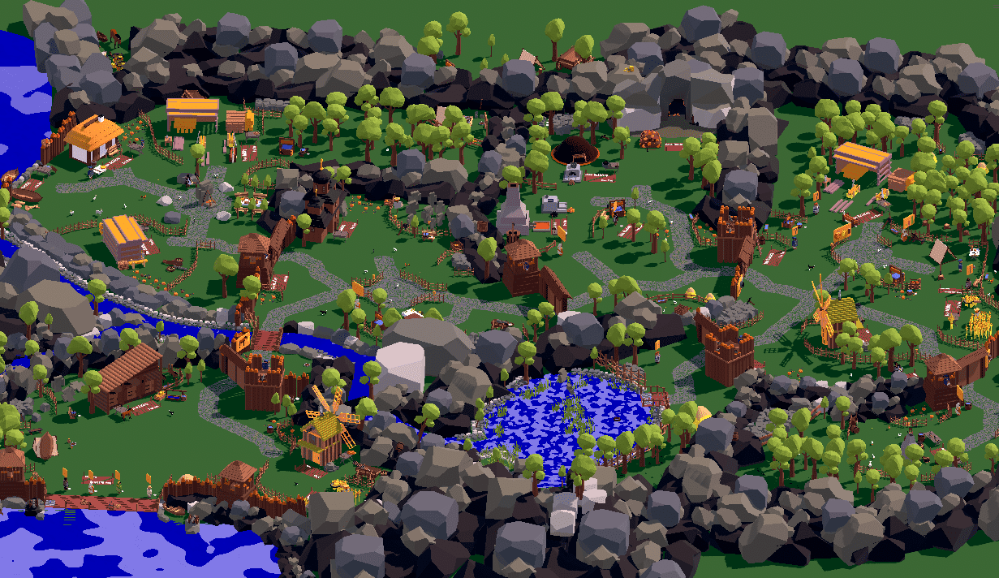
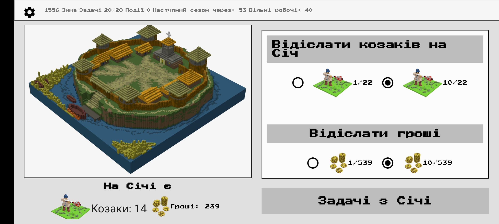
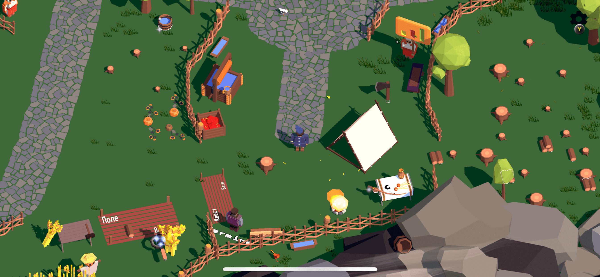
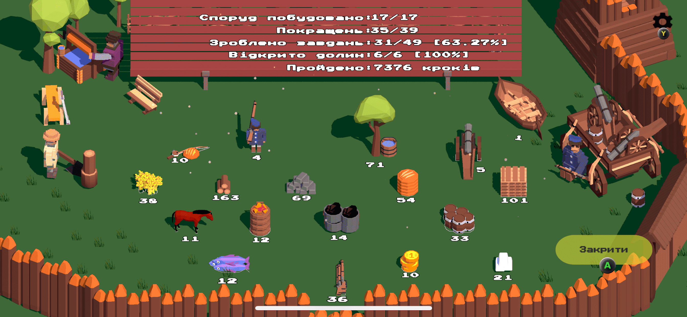
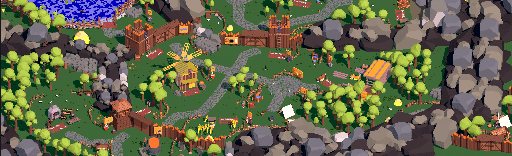
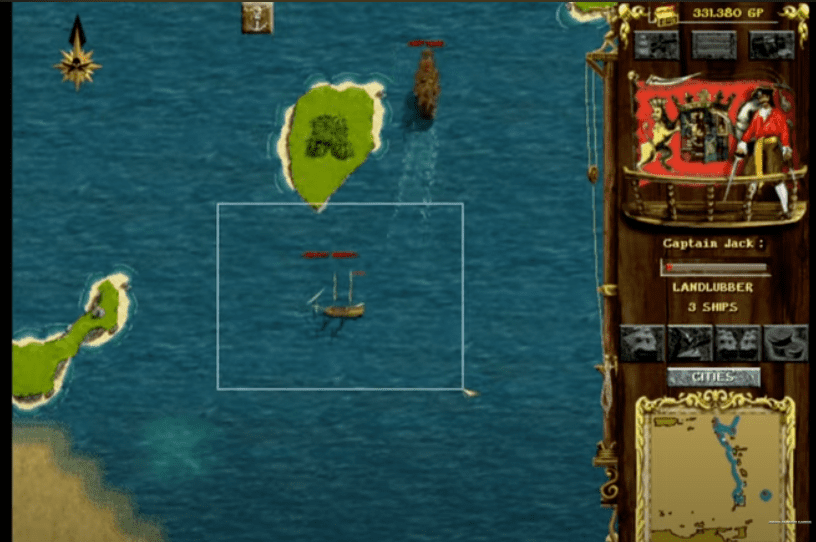

Wrapping things up and next plans

It's been over a year now that I've been working on my game Wild Fields: Sloboda 2.

I started it because you just can't live like this anymore, everywhere around there's some... There are very few mobile games with truly interesting gameplay and a play time that isn't toilet-sized (about 2 minutes). Apart from Kingdom: Two Crowns, it's hard to even think of a game you can play that has some kind of backbone, story progression, gameplay that changes as you go, and, most importantly, makes you want to play non-stop for 30-40 minutes. All mobile games are 2-minute sessions while you're sitting on the toilet. And I wanted every game session to be more than just earning coins or diamonds to buy the next item.

And there are no games about Ukraine either. There's Ostriv. Standing alone in the field. For 8 years already. I bought it as soon as it got onto Steam. And that's it. Total emptiness. 50 million people, and nobody has contributed anything useful to this part of our culture. And it's an extremely important and influential part. Look at the Russkies: all their gaming giants are funded either by the state or by Gazprom or other oil cash cows. Because through a game you carry your idea, you enrich your own cultural layer. All kids play mobile or cell phone games. So a little Ukrainian goes onto Steam to pick a game. Can he play anything about his own country? Or about its history? The Russkies have tanks, some RPG about Slavs and brawls with the Germans (exactly their thing — storming the Reichstag their whole lives), there's War Thunder... He'll install Ostriv, but that game is very niche, not everyone can handle it. The kid picks up a phone, and there's... GK and an idle farm. And that's it — the kid grows up cut off from the cultural layer. The parents can be patriots, volunteers and soldiers a hundred times over, but this kind of practical influence is minimal. It simply doesn't exist. There'll be Roblox and match-three. A Russian kid runs around a post-Soviet BioShock where the USSR didn't collapse but instead became mighty and beautiful. On his phone he plays tanks "for grandpa"... And a Ukrainian kid... fires a Bayraktar in some fart of a game, and that's it. And that's what he'll remember: our people can't make anything, while look at the Russians with their tanks and War Thunder... You see how everything gets programmed through games...

Back to me. Back in 2013 I made a turn-based multiplayer game, "Battle of Nations". Something like chess, where you take turns moving warriors and they fight the enemy. The game had Poles, Turks, Ukrainians (Cossacks) and Tatars. But I needed art, so I dropped it all. Six years passed, and I realized that in that time I could basically have finished another university... let alone learn to draw and make game art. And I decided not to stop no matter what. That's how the "Wild Fields" universe was born.

# Wild Fields

Wild Fields started with interactive stories about Cossacks. [Interactive stories](https://locadeserta.com/interactive/). Surprisingly, readers now write interactive stories themselves and add them to the catalog. I'm very impressed. Because I'm not working on that game anymore.

Then came: Sloboda (the first one, not this one :) ), Chumaky, Hex: [All available games](https://locadeserta.com/all_games_uk.html). All in the same style and all connected to Ukraine. Specifically, to the Cossack era. For these games I prepared about 200 different 3D models in voxel style. Which made it possible to start my next game. These games still get about 100 installs a month each, which is yet another miracle for me :)

But. These were games made on my knee. Even though they had ten times more gameplay than other mobile games.. I used Flutter to ship them on all platforms. But it's not a game engine. So in the fall of 2021 I decided to remake Sloboda, but for real this time, as a full-fledged game. Luckily, I already had quite a lot of art and 3D voxel models, so I started reworking the primitive "imagine the rest yourself" gameplay of the first Flutter Sloboda.

# Wild Fields: Sloboda 2

[All videos on TikTok](https://www.tiktok.com/@locadeserta/video/7167762541311986949?is_copy_url=1&is_from_webapp=v1)

I can say with confidence: Sloboda 2 is the first game about Ukraine on mobile. One that has a story, quests, immersion in the 17th century. But without the pompous nonsense games often do. Instead, it's everyday life: you're the otaman of a Sloboda that you have to found, build up, reach the sea and help the Sich. No magic, diamonds, IAP or Ads SDK. A pure game. About 2-4 hours of continuous play to finish it. Yes, the game has an ending. But you can keep running around the map afterwards. Got the 21st achievement, "Game Over" — consider the whole game beaten.

For atmosphere and immersion we commissioned three original soundtracks. From classic kobzar songs to 18th-century classical music and modern stuff. Yes, the game has kobzars, real NPCs who play the bandura. Walk up to them and they'll play for you. In the game you'll have to send help to the Cossacks at Azov. Did you know that our Cossacks stormed that Turkish fortress and then refused to give it back for several years? And thanks to the game, your kid will find out about it. Or even you yourself. And the meme about Polubotok's Gold? I still remember characters from my childhood who claimed that Polubotok's gold was buried in Oster, and the Japanese wanted to find it, but our people wouldn't let them... Things like that unite the whole nation. Because a kid, an adult or a teenager plays something of their own, and they already have points of contact. From Zakarpattia to Luhansk, something will connect people. For the Russkies it's "grandpas fought in the war", which permeates all their games. We need to have the Wild Fields: the place where Ukraine was formed, with the Cossacks and the Hetmanate.

# What's next

In December 2022 we release Sloboda 2. A full-fledged game. Maybe we'll even release it on Steam at the end of winter. But for now the focus is 100% on mobile platforms. Everyone has them. Looking at the kids at school — nobody even dreams about a PC anymore... you have a phone, why would you need anything else? Each of our next games will build on the previous ones: reusing art and sounds. In general, it's easier to make things when something is already made.

January 2023, the first patch: we'll finish what we didn't finish :)

February 2023: the first content patch: a new map. Khadzhibey-Odesa. We'll be setting up a Cossack sloboda there too. Whoa, and that's how players will find out that Odesa wasn't founded by some Katka with Potemkin, but by actual Tatars, Turks and Cossacks... Feel the influence games have?

December 2023 (a year from now): release of the next game, "Cossacks: Terror of the Black Sea". We'll be sailing dubas, baidaks and lypas around the Black Sea, sinking Turks, squeezing Tatars... capturing Crimean villages. In my head: take the ideas and gameplay of the old game [Corsairs: Conquest at Sea](https://www.youtube.com/watch?v=6D77IF9lJ9g&t=636s)

But first, the release of Sloboda 2 on Apple and Google platforms.

Dmytro Gladkyi, November 20, 2022.
