Hi everyone!

Today we'll build the first truly cross-platform app of your life with Flutter. Unlike React Native, we won't use JS crutches and other heresy to get your app running on all the major platforms from the same source files.

To avoid making trivial apps in the style of Counter/ToDo App, the way React developers love to, we'll write a lite player for interactive stories taken straight from https://locadeserta.com.

All the source code is here:
https://github.com/gladimdim/litelocadeserta

# Installing Flutter

Unlike the JavaScript ecosystem and related systems (React Native), the installation is very well documented and works on all platforms. You also don't need to install any gadgets like https://expo.io on your devices. So I'll just give you the link:

https://flutter.dev/docs/get-started/install

# Creating the Project
Flutter ships with great command-line tools. Creating a new app starts with:

```
flutter create litelocadeserta
```

Flutter will create all the necessary directories, configs and so on.

Currently the Flutter tools support creating projects for iOS and Android. For desktop platforms (technical preview) and the web (beta) you need to switch to the master branch:

```
flutter channel master
flutter upgrade
flutter doctor
```
And enable desktop and web support:

```
flutter config --enable-windows-desktop
flutter config --enable-linux-desktop
flutter config --enable-web
flutter config --enable-macos-desktop
```

After that, if you run the command

```
flutter devices
```

you should see your desktop platform in the list of available devices:


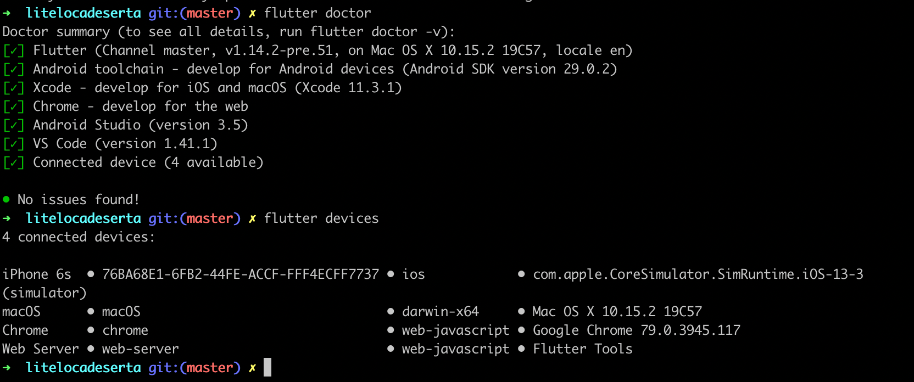

The Windows and Linux platforms haven't been added to the Flutter repository itself yet, but according to the official documentation we can simply copy the runners from the examples folder of the https://github.com/google/flutter-desktop-embedding repository

More information is here: https://github.com/flutter/flutter/wiki/Desktop-shells

# Adding the macOS Project

If you saw macOS in the list of available devices to run the app on, you can generate a runner for our game:

```
flutter create .
```

And then run our app, written in Flutter, as a native application:

```
flutter run -d macOS
```

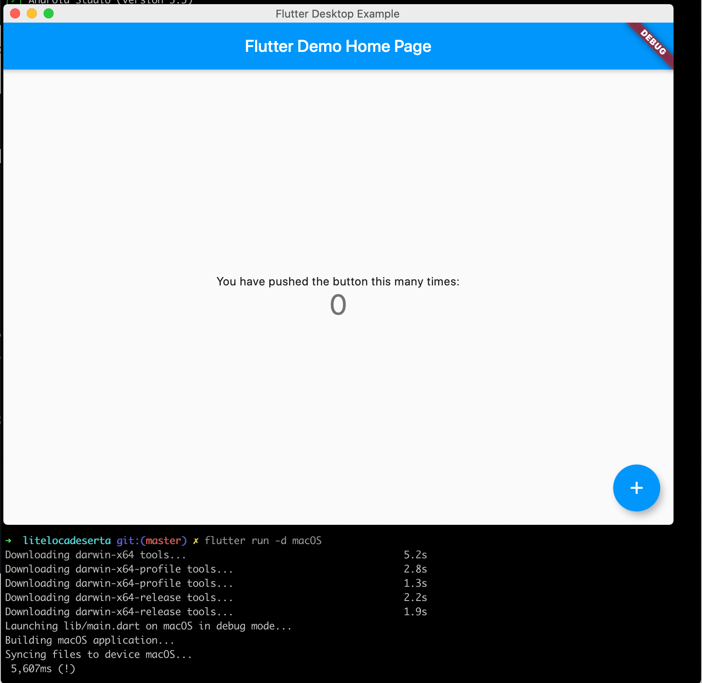

# Running on the Web

The flutter create . command also created everything needed to run the app on the web:

```
flutter run -d chrome
```


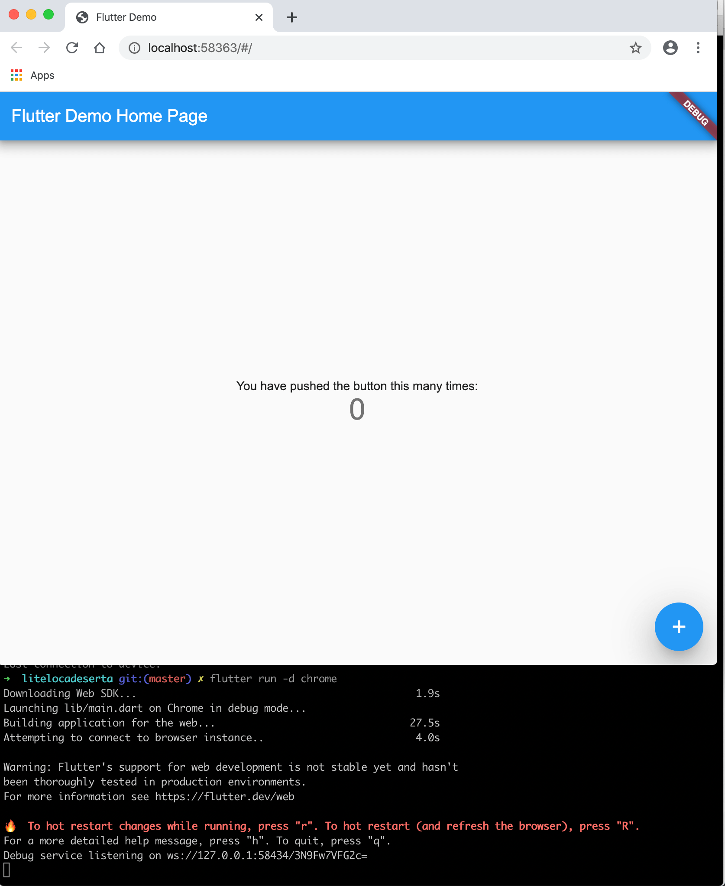

# Adding Third-Party Packages

Adding a new package is pretty easy. Go to https://pub.dev, find the package you need and look at the "Installing" tab. Usually it all comes down to adding one line to pubspec.yaml:

```
dependencies:
  gladstoriesengine: ^0.2.3
``` 

And then fetching the changes:

```
pub get
```

If you use the official plugins for VS Code or Android Studio, the plugin will notice the changes in this file by itself and fetch them automatically:

Here's what happened after saving the changes to the file:
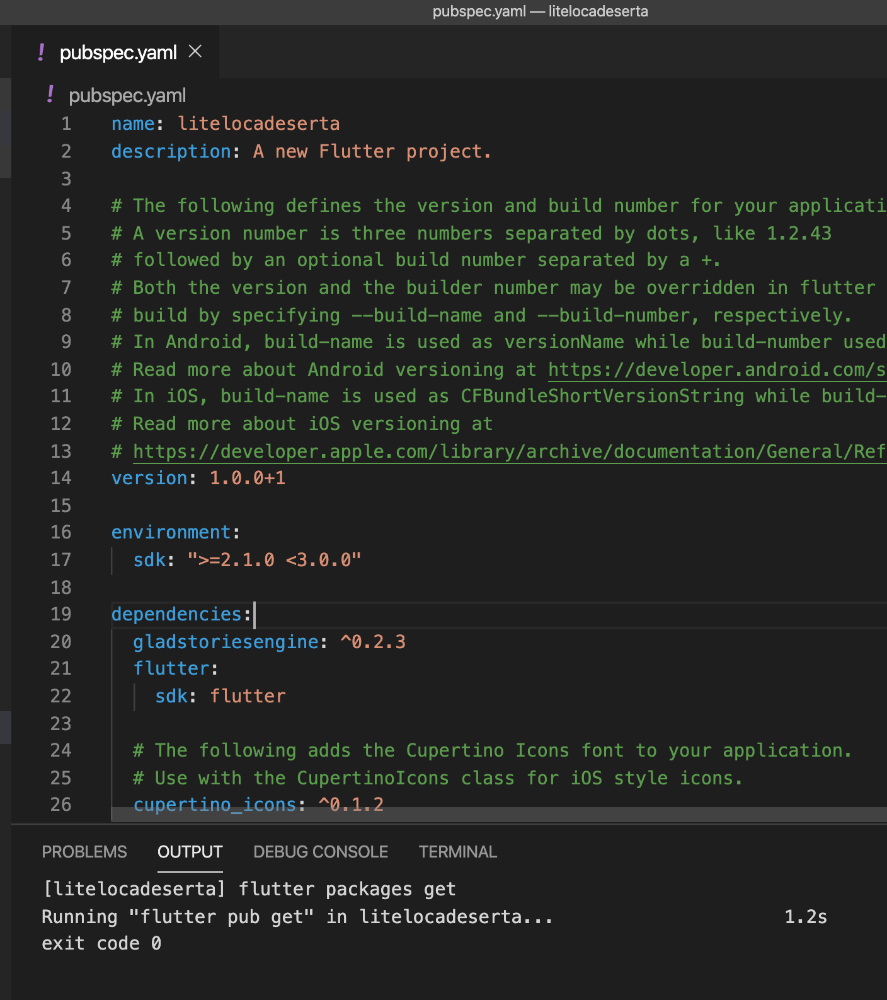

To play interactive stories created in the [GladStories](https://github.com/gladimdim/GladStoriesEngine) format, we'll take the official package: https://pub.dev/packages/gladstoriesengine

pub.dev is very convenient to use, since it immediately shows which platforms a package is compatible with, how to install it and other details:

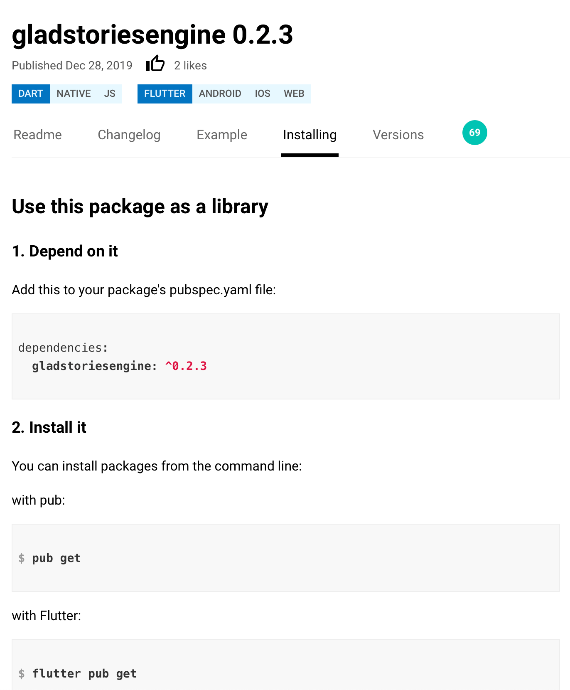

# First Steps

Before you start writing new code, I recommend reading the official documentation on widgets: https://flutter.dev/docs/development/ui/widgets-intro . From here on I assume you know the difference between a Stateless and a Stateful widget (the first just renders its input data, the second can change its own state and update its rendering).

## Adding Our Own Widget

Find the lib/main.dart file and delete all the comments from it so they don't get in the way.

Replace the build method with:

```
 Widget build(BuildContext context) {
    return Scaffold(
      appBar: AppBar(
        title: Text(widget.title),
      ),
      body: GameView(),
    );
  }
```
Dart is not JavaScript, so it will immediately tell you that it doesn't know what GameView() is.

### Now for a Bit of a Serious Talk.

Flutter is a live environment. Once you've launched a Flutter app, you don't need to rebuild and restart it every time you change files. Flutter does that automatically. And it preserves the app's runtime state. That is, if you navigated to some part of the app, entered some data, loaded something from the internet, then after a live reload all those changes will still be available to you!

Because of this, Flutter developers often add not-yet-existing widgets to the app in order to quickly sketch out the main layout of a component. The Flutter authors even added a dedicated widget for exactly this need: https://api.flutter.dev/flutter/widgets/Placeholder-class.html

## An Asynchronous Widget

Now we'll implement GameView by adding a new file lib/game_view.dart.

Open it and type three letters: stf . The editor will automatically offer to create a Stateful Widget skeleton:

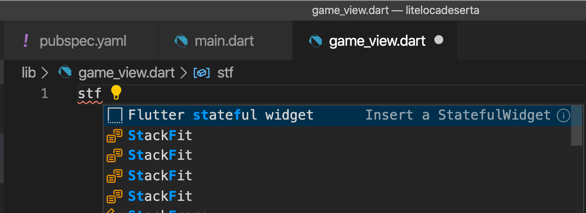

Click the first option and the skeleton of our widget appears. But with lots of errors:


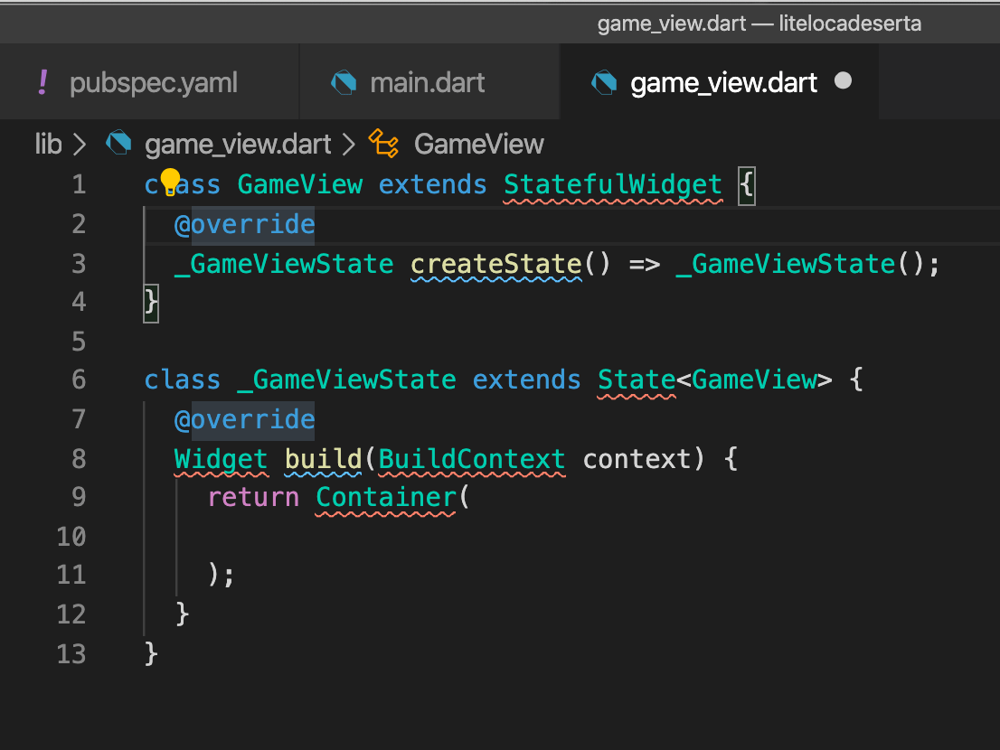

Click the light bulb and add the missing imports:

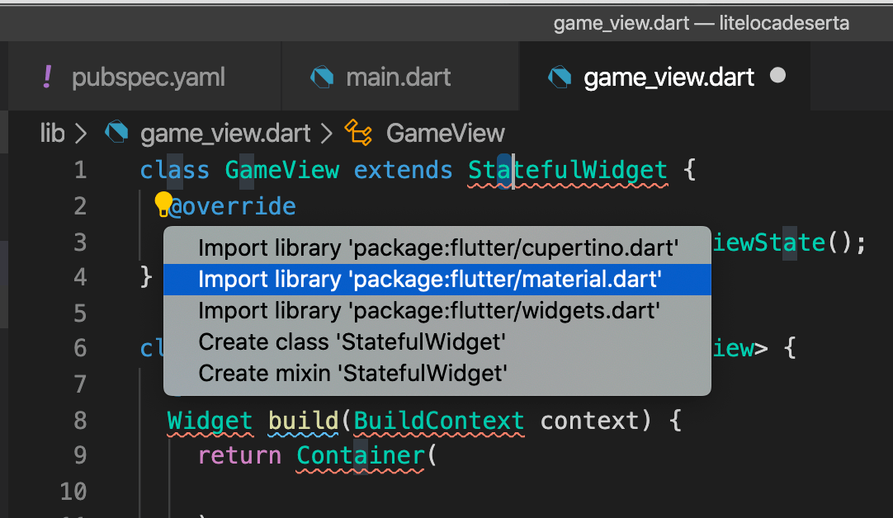

Now go back to main.dart and add the missing import via the same light bulb:

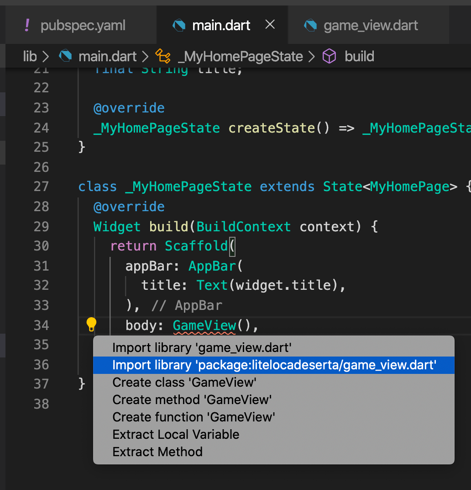

Run our app via Debug -> Start Debugging, and we see our new widget rendered on screen.

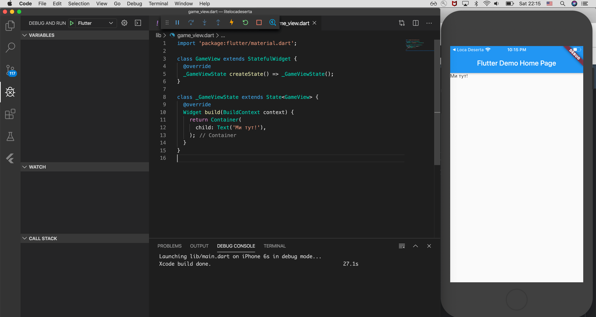

We'll be downloading the data for our interactive story from the internet. So we need to wrap the Container in a FutureBuilder widget. This is a special widget that knows how to work with asynchronous events and lets you build different widgets depending on the state of the asynchronous operation.

Flutter has extremely good plugins, so this is very easy to do: put the cursor on Container and press cmd + .

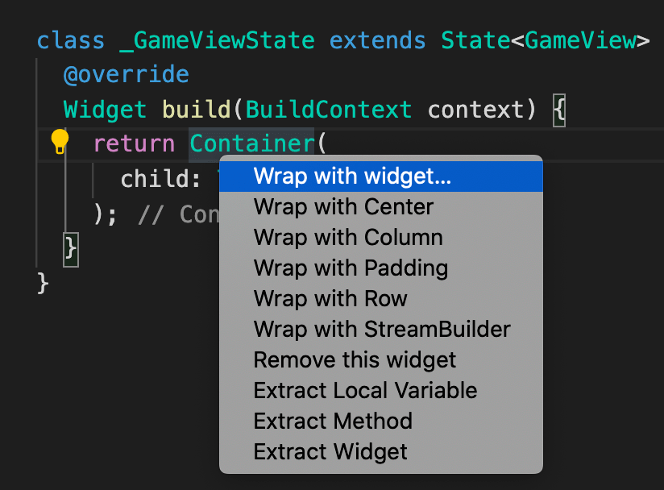

Choose Wrap with Widget  and type FutureBuilder, adding the required parameters for its constructor:

```
return FutureBuilder(
      future: _fetchData(),
      builder: (context, snapshot) => Container(
        child: Text('Ми тут!'),
      ),
    );
```

And now we need to add the _fetchData method, which will load the data from the internet.

```
import 'package:flutter/material.dart';
import 'package:async/async.dart';
import 'package:gladstoriesengine/gladstoriesengine.dart';
import 'package:http/http.dart' as http;

class GameView extends StatefulWidget {
  @override
  _GameViewState createState() => _GameViewState();
}

class _GameViewState extends State<GameView> {
  final AsyncMemoizer _storyGet = AsyncMemoizer();
  @override
  Widget build(BuildContext context) {
    return FutureBuilder(
      future: _fetchData(),
      builder: (context, snapshot) => Container(
        child: Text('Ми тут!'),
      ),
    );
  }

  Future _fetchData() async {
    return _storyGet.runOnce(() async {
      var result = await http
          .get('https://locadeserta.com/stories/published/krivava_pastka.json');

      return result;
    });
  }
}

```

Getting a bit ahead of myself: you need to use AsyncMemoizer here. Without it, this widget would download the data on every rebuild event in the app. Since we only need to download the json once, we memoize the result of the asynchronous operation, and it will run only once (the first time).

Now we need to change the builder, since the asynchronous operation doesn't finish immediately and may take some time. For this, the snapshot variable has special flags that tell you whether the asynchronous operation has finished.

Change the builder:

```
builder: (BuildContext context, snapshot) {
        switch (snapshot.connectionState) {
          case ConnectionState.none:
          case ConnectionState.active:
          case ConnectionState.waiting:
            return CircularProgressIndicator();
            break;
          case ConnectionState.done:
            var story = Story.fromJson(snapshot.data.body);
            return Text(story.title);
        }
        return null;
      },
```

We handle the execution state of the Future. If it hasn't completed, we show a circular progress bar. If it's done, we load the JSON into Story.fromJson for parsing and processing.

Now we can see the story's title:

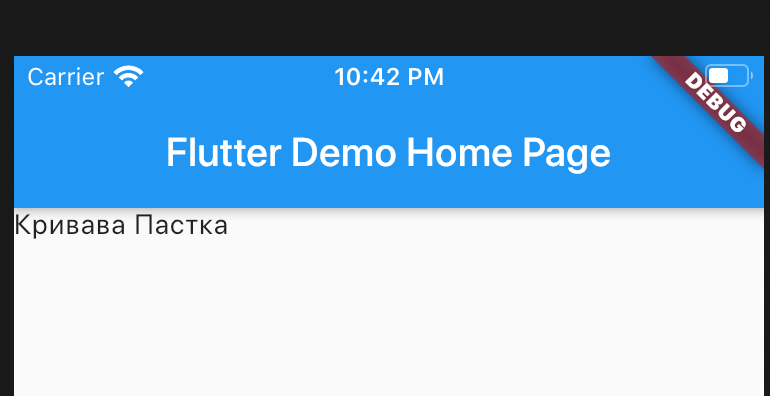

# Building the Story Widget

Now that we have the data, we can create the next widget, which will actually handle playing the story.

StoryView takes an instance of the Story class as input. This class contains all the methods needed to work with an interactive story: playing paragraphs, asking questions, receiving answers to questions. All of that is outside the scope of our project, so WHOOSH and the widget is ready:

```
  Widget build(BuildContext context) {
    return StreamBuilder<List<HistoryItem>>(
      stream: widget.story.historyChanges,
      initialData: widget.story.history,
      builder: (context, snapshot) {
        var history = snapshot.data;
        return Column(
          children: [
            _buildTextSection(history, context),
            if (widget.story.canContinue()) createContinue(context),
            if (!widget.story.canContinue())
              ...createOptionList(widget.story.currentPage.next),
          ],
          crossAxisAlignment: CrossAxisAlignment.stretch,
        );
      },
    );
  }
```

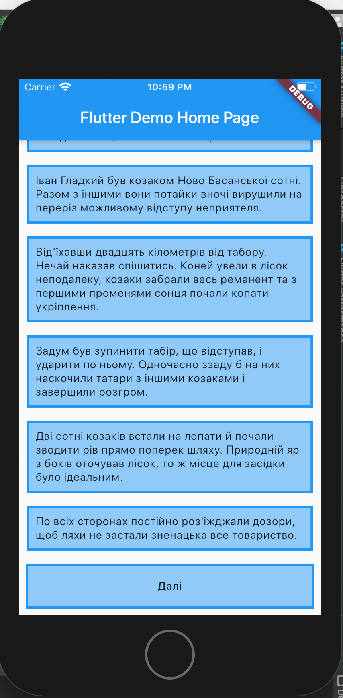

What happened here. StreamBuilder is a special widget that works with  streams. We need it because Story contains a stream of the paragraphs played in the story. Every time the player changes the story, a new array with all the passed paragraphs, dialogue choices and so on is added to this stream. And the widget gets the chance to rebuild itself, but with the new data from the Story's history stream.

Dart recently added the ability to put if and '...' right inside collection rendering, which is very handy. Don't mind all the other widgets, they're there for looks. For example, borders on containers, or the button press animation. You can just look at how it's done on GitHub.

# Running on macOS!

And now we take this very same code without a single change and run it as a native app on Apple. **Once again**. This is not running some React Native bridge that translates your CSS/JS/HTML into native controls and tries to perform at 60 FPS somehow. Flutter is native code right away. No bridges.

Before running, you need to add a macOS entitlement to be able to make HTTP requests. To do that, add this to the macos/Runner/DebugProfile.entitlements file

```
<key>com.apple.security.network.client</key>
<true/>
```

Running on macOS:

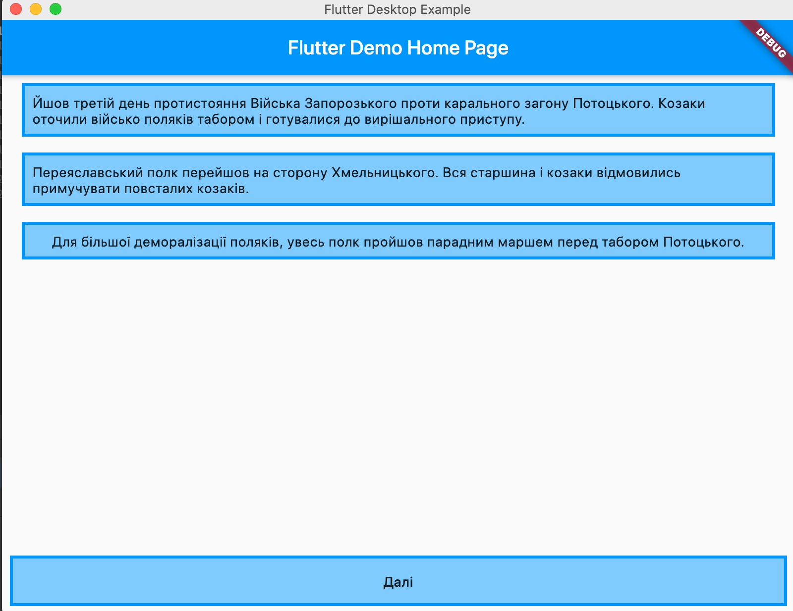

# Running on the Web!

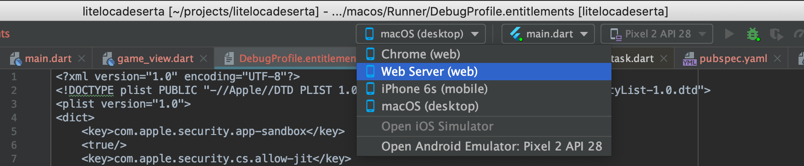

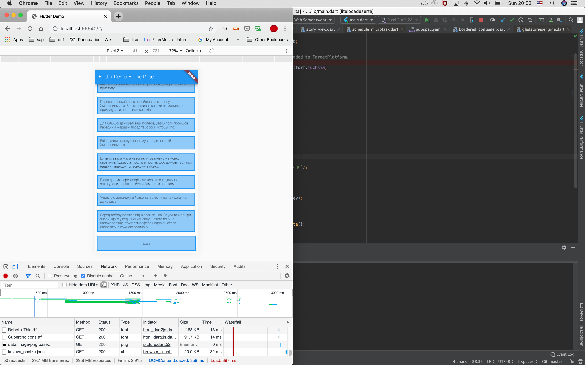

It works!

# Running on Windows!

Go to your grandma's, or to the .NET adepts, and run our project there too (first install Visual Studio + the C++ package; flutter doctor will tell you everything you need to install):


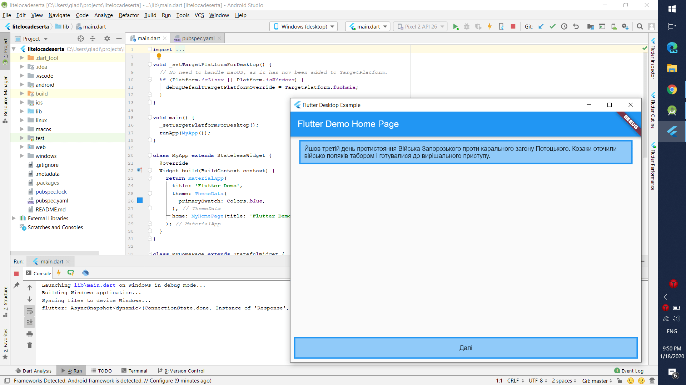

# Running on Linux!

```
flutter doctor
```

It will tell you that clang++ is missing. You can install it like this:
```
sudo apt-get install clang
```

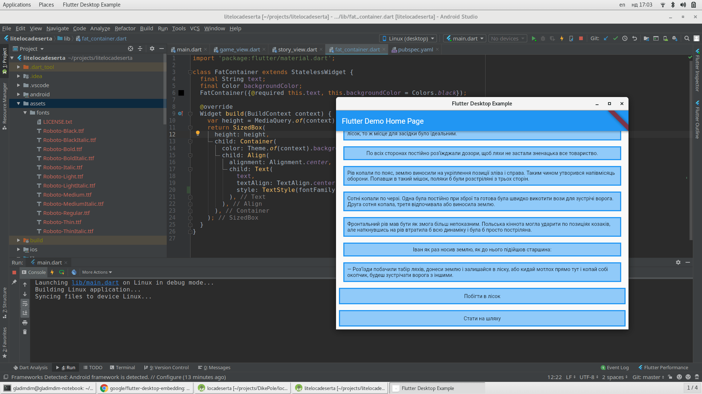

# All Together on macOS

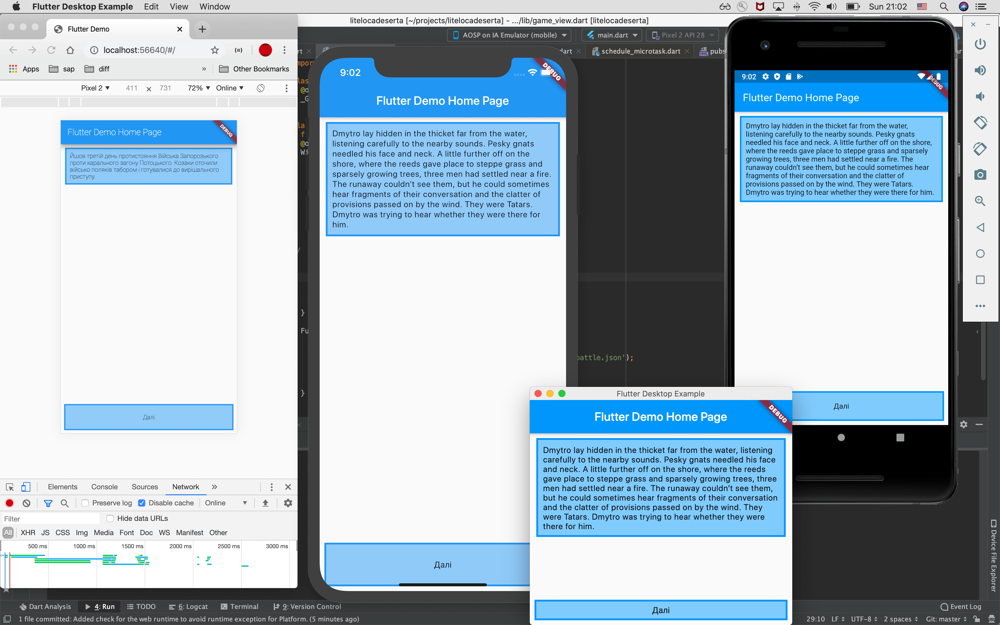


# Epilogue, or Why It's Time to Jump on the Flutter Train

- Forget JavaScript. Its haze has finally started to clear. Crutch technologies like Cordova, React Native, Ionic, electron are becoming a thing of the past. Another extremely strong player has entered the arena, winning over more and more programmers with how convenient it is to develop in. TypeScript didn't live up to expectations and is in complete stagnation (but compiling a TypeScript project still takes as long as compiling an iOS build)

- The Dart language is extremely easy to learn. If you knew C-like languages, you'll have no problems. Also, unlike other new languages, it doesn't suffer from ML-itis or other strange syntax diseases from category theory.

- Forget HTML+CSS. The CSS Mafia won't reach you in the CSS universe. If you, like me, became its victim and still don't know how to reliably center text vertically with CSS (and have it actually work in an existing BIG project and in all browsers: Safari, Chrome, Mobile Chrome, Mobile Safari). CSS will never reach 60 FPS; building user interfaces with HTML and its DOM model was a mistake that people just kept dousing with gasoline, and this bubble swelled into absolutely moronic solutions like Shadow DOM, SSR, Virtual DOM (and its twenty tree diffing algorithms) and more.

- Finally, proper tooling. You won't need to know twenty terminal commands and a hundred flags for them to compile and run your project (unlike the JavaScript ecosystem, where every lib drags along its own binary tools to work with it). Everything works through the flutter command, and you'll most likely need only two of its commands: flutter build, flutter run.

- Flutter Doctor is 🤯. If something in your setup doesn't work,  just run:

```
flutter doctor
```

And it will tell you all the installation errors you missed. For example, when I was building this project on Windows, the command gave me a link to download Visual Studio and pointed out which packages and sub-packages to install. Then it even let me know that Visual Studio was waiting for a Windows restart!

**If you're interested in reading more about Flutter**, subscribe to my RSS, join our Telegram channel: https://t.me/artflutter, or our Discord server: https://discord.gg/n8WUCja , and read my previous article about a custom app bar: [[flutter-creating-custom-scaffold-with-app-bar|Flutter: Creating Custom Scaffold with App Bar]]

**You can find the full version of the interactive gamebook** here: https://locadeserta.com. Available online, on iOS and Android.
