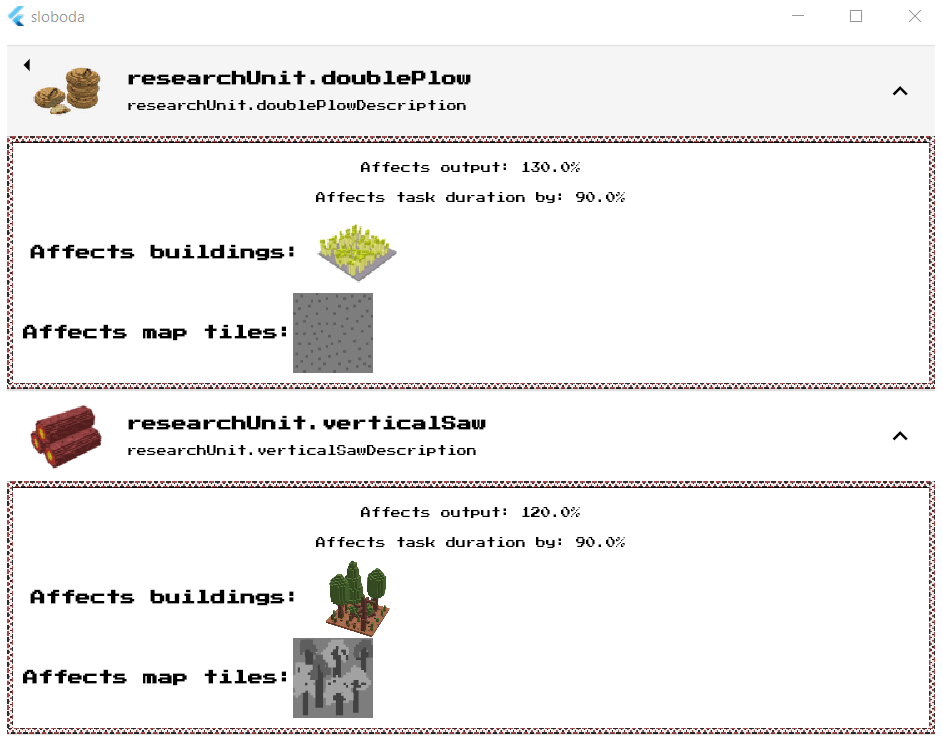

# Introduction

In my game [Wild Fields: Sloboda](https://locadeserta.com/citybuilding) I decided to add the ability to spend earned Glory points on improving production processes. Something like Research in other games, where the player can unlock branches, new buildings, military units, etc. Since my game is focused on the economy, I decided to start with purely production processes. All the code in this article, just like in the game, is written in Dart combined with Flutter.

At the end of the article you'll also find the differences between the OOP and FP approaches, and why, in my opinion, OOP beats FP.

# Requirements for Research

Before creating a design, we need to write down concrete requirements.

A Research must:

- define the number of Glory points needed to unlock it
- define the amount of resources needed to unlock it
- a name
- a description
- an icon
- a list of effects that are applied to a building or a map tile.

# Creating the ResearchUnit class

This class will satisfy all the requirements.

```
class ResearchUnit {
  final String localizedKey;
  final String descriptionKey;
  final num gloryRequired;
  final Stockable stockRequired;
  final List<ResearchUnitEffect> effects;
  final String iconPath;
  bool unlocked;

  ResearchUnit({
    this.effects,
    this.localizedKey,
    this.descriptionKey,
    this.gloryRequired,
    this.stockRequired,
    this.unlocked = false,
    this.iconPath,
  });
}
```

# Requirements for effects
Each research unit has an array of ResearchUnitEffect, which defines what changes in the sloboda, and how, if the parent research is unlocked.

Requirements for effects:

- defines the list of building types it affects
- defines the list of map tile types it affects
- a coefficient affecting the production input requirements
- a coefficient affecting the production output
- a coefficient affecting the production duration
- the effect can tell whether it will affect a Building or a Map Tile.
- the effect can tell what the production input/output will be if this effect is applied.

An example of effect coefficients. Let's say we have a Sawmill that produces 30 planks, and for that it needs 10 wood. One such task takes 45 seconds.

In the sawmill model this is described via a special Taskable class:

```
  Taskable defaultTask = Taskable(
    workers: 1,
    duration: Duration(seconds: 45),
    input: Stock(values: {RESOURCE_TYPES.WOOD: 10, RESOURCE_TYPES.FOOD: 5}),
    output: Stock(values: {RESOURCE_TYPES.PLANKS: 30}),
  );
```

If the input coefficient equals 0.5, it means the amount of wood (the sawmill's input resource) is halved, from 10 to 5.

# Creating the ResearchUnitEffect class

This class will satisfy all the requirements described above:
```

class ResearchUnitEffect {
  final List<RESOURCE_BUILDING_TYPES> resourceBuildingTypes;
  final num inputCoefficient;
  final num outputCoefficient;
  final num taskCoefficient;

  final List<MAP_TILE_TYPES> mapTileTypes;

  ResearchUnitEffect(
      {this.resourceBuildingTypes = const [],
      this.inputCoefficient,
      this.outputCoefficient,
      this.taskCoefficient,
      this.mapTileTypes = const []});

  void affectCity(Sloboda city) {}

  bool canAffect(dynamic object) {
    if (object is ResourceBuilding) {
      return canAffectBuilding(object);
    }
    if (object is ResourceSpot) {
      return canAffectResourceSpot(object);
    }
    return false;
  }

  bool canAffectBuilding(ResourceBuilding building) {
    return resourceBuildingTypes.indexOf(building.type) >= 0;
  }

  bool canAffectResourceSpot(ResourceSpot spot) {
    return mapTileTypes
        .intersection(spot.suitableTypes, (a, b) => a == b)
        .isNotEmpty;
  }
}
```

An interesting feature of Dart is its dynamism.

For example, the method:

```
  bool canAffect(dynamic object) {
    if (object is ResourceBuilding) {
      return canAffectBuilding(object);
    }
    if (object is ResourceSpot) {
      return canAffectResourceSpot(object);
    }
    return false;
  }
```

takes the input parameter **object **of type **dynamic**. Since an effect can affect either a Building or a Tile, and these are completely different classes, this method was made specifically for consumers of this API, so they don't have to decide which method to use before every call to **canAffectBuilding/ResourceSpot**. That responsibility is moved to the effect itself. If the effect has no idea what class of object it was given, it simply returns false.

### Tests for canAffect

Since the functionality can get fairly complex, it's better to write tests before writing the code for the methods.

Let's say we have this research:

```
    var effect = ResearchUnitEffect(
      resourceBuildingTypes: [
        RESOURCE_BUILDING_TYPES.SAWMILL,
        RESOURCE_BUILDING_TYPES.FOREST
      ],
      mapTileTypes: [MAP_TILE_TYPES.FOREST],
      inputCoefficient: 0.5,
      outputCoefficient: 2,
      taskCoefficient: 0.5,
    );
```

We can immediately write tests for **canAffect**:

```
    test("Can use dynamic method to tell whether it affects it", () {
      var spot = ResourceSpot.generateWood();
      expect(effect.canAffect(spot), isTrue,
          reason: "Dynamic method called correct spot method");

      expect(effect.canAffect(ResourceSpot.generateFish()), isFalse,
          reason: "Dynamic method called correct spot method");

      expect(
          effect.canAffect(
              ResourceBuilding.fromType(RESOURCE_BUILDING_TYPES.SAWMILL)),
          isTrue,
          reason: "Dynamic method called correct building method");

      expect(
          effect.canAffect(
            ResourceBuilding.fromType(RESOURCE_BUILDING_TYPES.MARKETPLACE)),
          isFalse,
          reason: "Dynamic method called correct building method.");
    });

```

### Tests for the affect* methods

And right away let's write tests that apply the effect to the production properties:

```
test("Can affect input value of the resource building", () {
      var building = ResourceBuilding.fromType(RESOURCE_BUILDING_TYPES.FOREST);
      var newStock = effect.affectBuildingInput(building);
      expect(
        newStock.getByType(RESOURCE_TYPES.FOOD),
        equals(7.5),
        reason: "New input stock is decreased.",
      );
    });

    test("Can affect output value of the resource building", () {
      var building = ResourceBuilding.fromType(RESOURCE_BUILDING_TYPES.FOREST);
      var newStock = effect.affectBuildingOutput(building);
      expect(
        newStock.getByType(RESOURCE_TYPES.WOOD),
        equals(20),
        reason: "New input stock is increased.",
      );
    });

    test("Can affect the duration of the Task.", () {
      var building = ResourceBuilding.fromType(RESOURCE_BUILDING_TYPES.FOREST);
      var duration = effect.affectBuildingTaskDuration(building);
      expect(
        duration.inSeconds,
        equals(10),
        reason: "Duration was decreased.",
      );
    });
```

## Implementing the affect* methods

Almost everything is ready; we just need to write three methods that change the input, output and duration of tasks:

```
  Stockable affectBuildingInput(ResourceBuilding building) {
     num adjuster = 1.0;
    if (canAffect(object) && inputCoefficient != null) {
      adjuster = inputCoefficient ;
    }
    return building.defaultTask.input * adjuster;
  }

  Stockable affectBuildingOutput(ResourceBuilding building) {
      num adjuster = 1.0;
    if (canAffect(object) && outputCoefficient != null) {
      adjuster = outputCoefficient ;
    }
    return building.defaultTask.output * adjuster;
  }

  Duration affectBuildingTaskDuration(ResourceBuilding building) {
       num adjuster = 1.0;
    if (canAffect(object) && taskCoefficient != null) {
      adjuster = taskCoefficient ;
    }
    return building.defaultTask.duration * adjuster;
  }

```

As you can see, all three methods are almost identical; they just work with different coefficients and object parameters.

Let's generalize the logic into a separate method:

```
 _affectObject(dynamic object, dynamic whatToAffect, num coef) {
    num adjuster = 1.0;
    if (canAffect(object) && coef != null) {
      adjuster = coef;
    }
    return whatToAffect * adjuster;
  }
```
Here we rely on the fact that consumers of this API may pass us any object. In that case the coefficient will be 1 and the logic won't change anything.

Let's rewrite the three methods:
```
  Stockable affectBuildingInput(ResourceBuilding building) {
    return _affectObject(
        building, building.defaultTask.input, inputCoefficient);
  }

  Stockable affectBuildingOutput(ResourceBuilding building) {
    return _affectObject(
        building, building.defaultTask.output, outputCoefficient);
  }

  Duration affectBuildingTaskDuration(ResourceBuilding building) {
    return _affectObject(
        building, building.defaultTask.duration, taskCoefficient);
  }
```

## All together

The design is almost done. Here's an example of a complete Research:

```
 ResearchUnit(
      localizedKey: 'researchUnit.doublePlow',
      descriptionKey: 'researchUnit.doublePlowDescription',
      gloryRequired: 5,
      stockRequired:
          Stock(values: {RESOURCE_TYPES.WOOD: 50, RESOURCE_TYPES.FOOD: 100}),
      effects: [
        ResearchUnitEffect(
          resourceBuildingTypes: [RESOURCE_BUILDING_TYPES.FIELD],
          mapTileTypes: [MAP_TILE_TYPES.GRASS],
          outputCoefficient: 1.3,
          taskCoefficient: 0.9,
        )
      ],
      iconPath: 'images/resources/food/food_64.png',
    ),
```

# Adding Research to the main class

In the game, the Sloboda class is responsible for everything. Any change to the inventory, the number of Cossacks, workers, etc., goes through this class.

```
class Sloboda {
    ...
  List<ResearchUnit> researches = defaultResearchUnits();
    ...
}
```

And that's it. Now Sloboda contains the list of researches available in the game.

# Adding the UI

We need to let the player see the list of researches, what their requirements are, and what they affect and how.

For this we create a separate widget that renders all available researches in a ListView:

```
  Widget build(BuildContext context) {
    return ListView(
      children: widget.city.researches
          .map((research) => research.toListTileView(context))
          .toList(),
    );
  }
```

Each ResearchUnit now has to know how to present itself to the player in the list:


```

// class ResearchUnit
Widget toListTileView(BuildContext context) {
    return ExpansionTile(
      initiallyExpanded: false,
      leading: Image.asset(iconPath),
      title: TitleText(
        this.localizedKey,
        textAlign: TextAlign.left,
      ),
      subtitle: Text(
        this.descriptionKey,
      ),
      children: [
        Column(
          mainAxisAlignment: MainAxisAlignment.start,
          crossAxisAlignment: CrossAxisAlignment.stretch,
          children: effects.map((e) => e.toWidget(context)).toList(),
        ),
      ],
    );
  }
```

The widget is an expandable UI element. It shows the icon, its name and a description text:



Each ResearchUnitEffect, in turn, knows how to display itself in the user interface:

```
Widget toWidget(BuildContext context) {
    return OrnamentContainer(
      child: Center(
        child: Padding(
          padding: const EdgeInsets.all(8.0),
          child: Column(
            children: [
              if (inputCoefficient != null)
                Padding(
                  padding: const EdgeInsets.all(8.0),
                  child: Text("Affects input: ${inputCoefficient * 100}%"),
                ),
              if (outputCoefficient != null)
                Padding(
                  padding: const EdgeInsets.all(8.0),
                  child: Text("Affects output: ${outputCoefficient * 100}%"),
                ),

// and so on
```

# Differences between the OOP and FP approaches.

You may have noticed that we mixed two different domains: the data model and the model of its on-screen representation (View). If we were writing in FP style, we'd have a function that takes a ResearchUnitEffect and draws it as a widget:

```
Widget researchUnitEffectWidget(ResearchUnitEffect effect);
```

But, in my opinion, it's better when the object itself answers the question: "how should you be shown to the player?":

```
Widget ResearchUnitEffect.toWidget()
```

This way we simply change the context in which we want to use this object, without resorting to external functions.

Say it had been written in FP style; then I'd somehow need to know the name of the function that converts my model into an on-screen widget. And if there are hundreds of such functions, how do I find out which one to use? **A small gap appears**, which we somehow have to smooth over (with fairy tales about FP being easier to test and other FP nonsense).

**If, however, we follow the bright path of OOP**, we simply tell the object: present yourself in a form suitable for the screen. That's it. We don't need to know which function to use. You can learn more about the fundamentals of OOP (not the nonsense that came from C++) from the authors of OOP at **Xerox PARC Group**: [Object-Oriented Programming, lecture by Daniel Ingalls](https://www.youtube.com/watch?v=Ao9W93OxQ7U)

That's exactly why all the data models in the game know how to display themselves on screen. From the FP point of view, I'm mixing absolutely different concepts (the model and how it looks on screen), but from the OOP point of view it's all correct.
