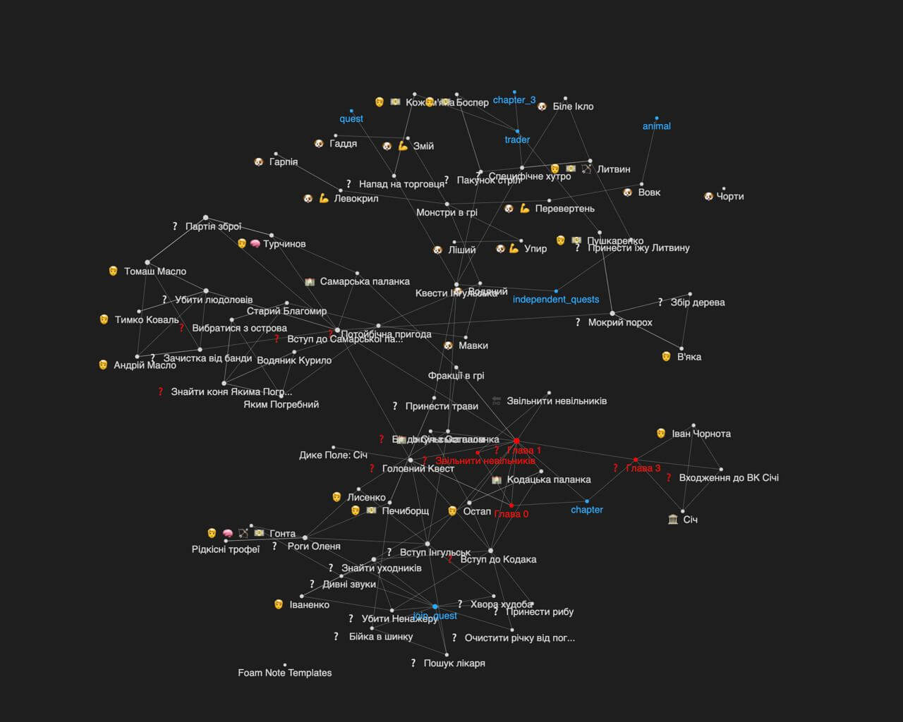
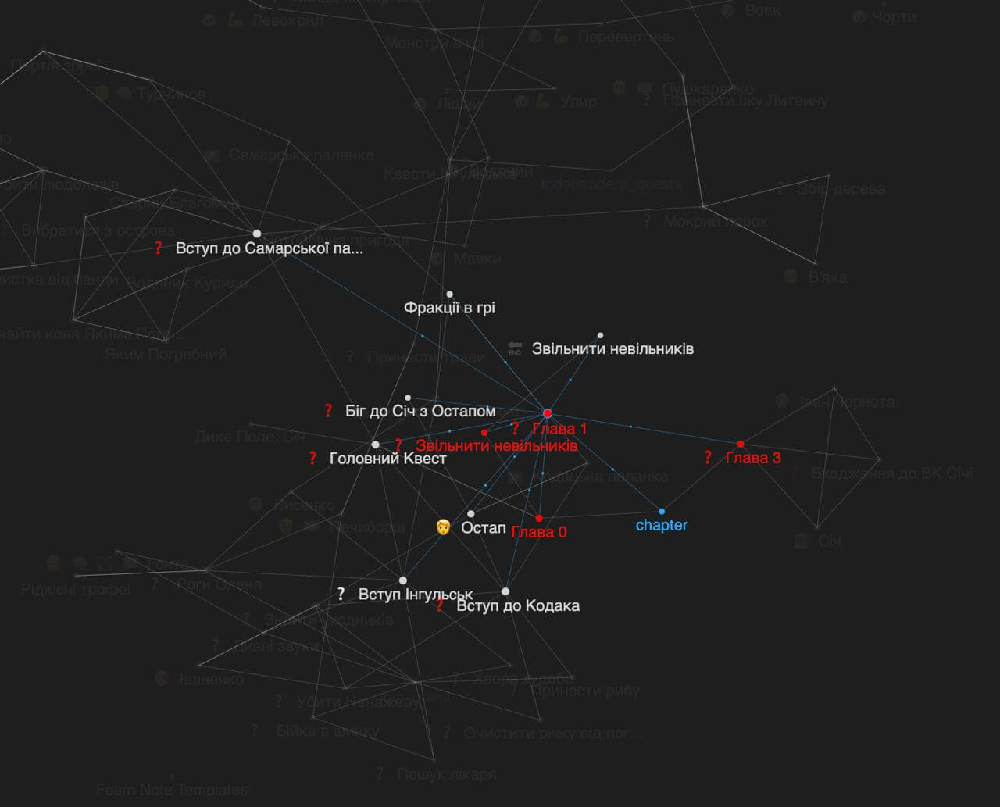

[After the topic on Gamedev DOU](https://gamedev.dou.ua/forums/topic/42399/) I'd like to remind you what the end goal
of the Wild Fields Universe is.

As you know, this universe includes all the games we make that deal with the period of history known
in Ukraine as "the Cossack era" (Kozachchyna). With every game we level up our skills toward the point where we can make a real, big role-playing game leaning as hard
as possible toward Gothic (1-2). Obviously, you can't make a game like that right off the bat. But here are the facts: back in 1997-2001 it was made by 7-14 people.
With the tooling available today it can be done by even fewer people. In "Wild Fields: Odesa-Khadzhybei" we are already adding an open world
and RPG elements in the form of quests that change the surroundings and unlock new possibilities.

In future games we will lean more and more into RPG elements, moving away from the production-chain gimmicks that dominate now.

And the main thing: all the games have to be on mobile. That brings a lot of limitations, but at the same time opens the door to any player.

**We will definitely make this game!**

# An Excerpt from the Main Quest

## ❓ The Main Quest

While you are sitting in Kaffa, a man who has been beaten half to death and is dying starts talking to you. He says the Cossacks will attack soon and you will have a chance to escape, since the attack will come unexpectedly. But his time is running out, and he tells you that he is a poturnak (a Christian who converted to Islam): he was captured as a teenager and they wanted to sell him on, but he converted to Islam and saved himself that way. He started working in Kaffa and over time rose to a certain position at the slave market. But he always stayed loyal to the Sich.

Through envoys he became an agent of the Koshovyi (the Sich's chief otaman), helping to exchange prisoners on both sides. But a month ago he learned a military secret: the Turks have decided to launch a huge raid on the lands of the Zaporozhian Host. They have already gathered supplies in Ochakiv for it and are only waiting for spring weather to ship men across the sea and strike the Sich as soon as it gets warm.

The military operation is being kept secret. He sent word to the Koshovyi, but the messenger was intercepted and he himself was seized too. They beat him almost to death, and today is the day of his execution. He hands the main character a ring and asks him to get to the Sich and warn the Koshovyi.

If he gives him this ring, the Koshovyi will know you are telling the truth. But only he will recognize it. It's better not to talk about this secret with other Cossacks, since they might run to the Turks themselves and, for a reward, report that their raid has been uncovered.

At that moment a wall with a door is smashed, and a cannonball kills the prisoner.

[[chapter_0]] begins

The main character's task: get to the Sich, get inside and obtain an audience with the Koshovyi.

To get into the Sich, you have to become a Cossack of one of the palankas [[вступ_інгульськ]] [[main]] [[join_samarska_palanca]]

To get to the Koshovyi, you have to complete two quests of your choice // TODO

During the audience the Koshovyi recognizes the ring and hears you out. He realizes this is a perfect moment for a pre-emptive strike, and that the entire Turkish army supply train can be captured. But for that it has to stay a secret for now. He asks you to start preparing for the raid, and for that you need to complete the preparatory quests:
