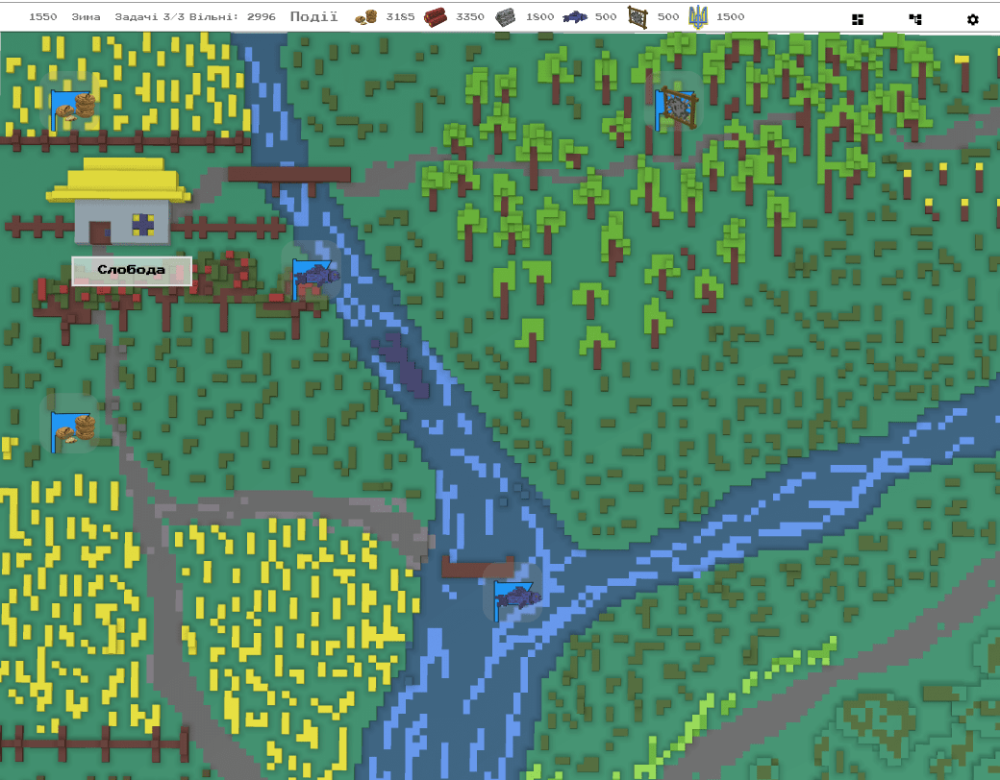

# TL;DR

The map of the surroundings has been completely reworked. It is now a hand-drawn voxel map.
Epic events have been rebalanced.
All in-game notifications now show how your inventory changed.

Video version: [https://www.youtube.com/watch?v=XpoF1Ybfrug](https://www.youtube.com/watch?v=XpoF1Ybfrug)

# Where to get the game?

The game is available online:  [https://locadeserta.com/sloboda/](https://locadeserta.com/sloboda/), but be careful - development builds are published there.

Release builds of the game are available on the Google Play Store:  [Wild Fields: Sloboda](https://play.google.com/store/apps/details?id=com.gladimdim.sloboda)

And on the App Store: [Wild Fields: Sloboda](https://apps.apple.com/ua/app/sloboda/id1543669328?l=uk)

You can also download the APK and Windows builds directly from GitHub:

[Release 3.0.5 on GitHub](https://github.com/gladimdim/locadeserta/releases/tag/3.0.5)

[Android APK build](https://github.com/gladimdim/locadeserta/releases/download/3.0.5/sloboda_305.apk)

[Windows 10 build](https://github.com/gladimdim/locadeserta/releases/download/3.0.5/sloboda_windows_305.zip)

# New map of the surroundings

The map is no longer randomly generated from different tiles - it was drawn in voxel graphics instead. Resources and events still appear on it, just like before.

Resources appear in the places where they belong. So wood shows up in the forest, while messengers from the Sich and scouts appear on the farmsteads, or near the camp of the frontier hunters in the east, by the forest and the lake.

There are other objects on the map too: a lake, a river, fields, an orchard, a camp, a Scythian burial mound and a stone quarry.

# Reduced impact of catastrophic events

Some epic events used to wreck the sloboda really badly. Now they don't happen as often, and the chance of them hitting you has gone down.
