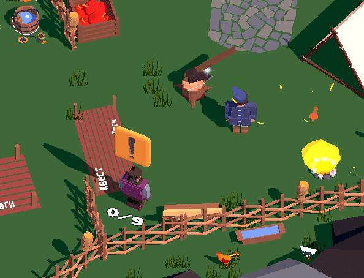
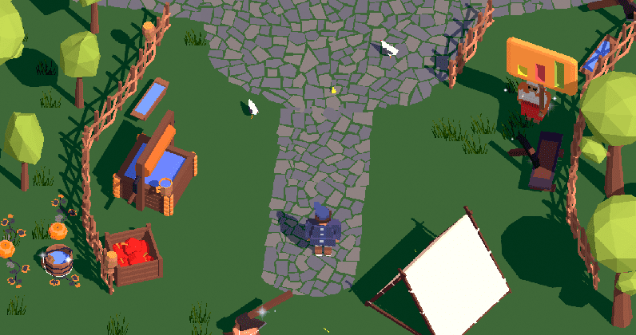
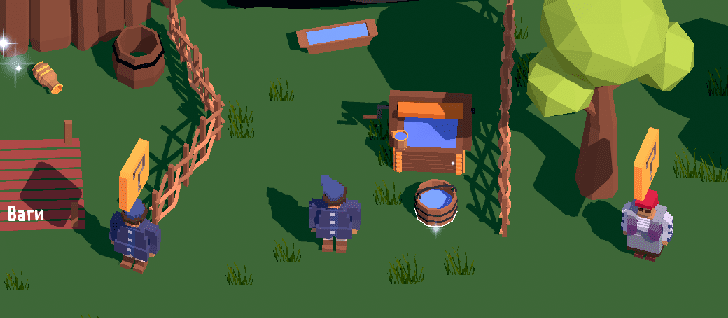
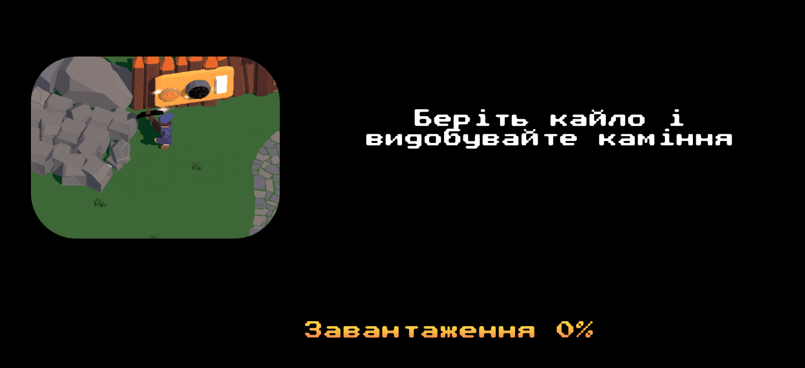
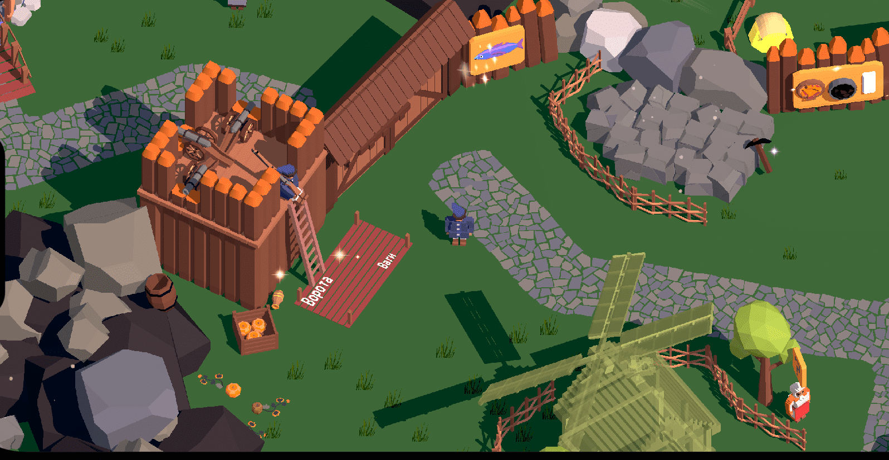

Just in case, I'm stashing a copy of my interview with Mezha.Media here. It turned out pretty long. Enjoy!

# Tell us about yourself

I live and work in Kyiv. I've been in the software development industry since 2006. I started making my first game for iOS in 2012, but dropped it because I needed to draw the art and I couldn't be bothered :) Even though the game was a turn-based multiplayer thing similar to chess and already had the core gameplay programmed...I still really regret abandoning it. But sometime in 2018 I remembered it and decided that this time I would definitely make games all the way to a release in the app stores. That's how the continuation of my "Wild Fields" universe came about. All the games are set in the 17th-18th centuries, specifically the Cossack era. I started developing games "for real" a year ago - in the autumn of 2021. I took on remaking my first Sloboda in the Unity engine, because before that I'd been using Flutter, which isn't a great fit for games. I do all the development publicly on my Telegram channel: [Loca Deserta Universe](https://t.me/locadesertachumaki).

# The team

Development is just me and my wife. Other people made some art for me, but sometime in the summer we completely switched from a Voxel to a Lowpoly art style. That's exactly when my wife started helping. 95% of the art in the game is her work in Blender. I have my own vision and goals for the games I want to make, so I don't want to join anyone. I also don't think, at the moment, that anyone else will join us. My wife and I are working, so to speak, on our own dime, and hiring someone else means more development time, communication, fixes, ping-pong and so on. Although a girl did write music for us. But that was simple: I sent her the songs that needed to be played on the bandura. She sent me a wav - I sent her money.

Making money

All my previous games: Sloboda, Chumaky, Interactive Stories, Hex are free, because I understood that the games are very niche, plus they don't look like mobile games. I earn enough at my main job, so I didn't add any ads, coins, user data harvesting or other monetization methods of the modern mobile games market. But Sloboda 2 will be paid: around 100 UAH. This is a full-fledged game, just the main playthrough takes 3-4 hours. My long-term plans include a remake of Gothic 1, but set at the Sich. The game is simply called Sich. I'm already working on it, the first 2 chapters are written. But right now I don't have the strength or the experience for it. Unless I work on it 16 hours a day, but then I'd have to quit my job...so Sloboda 2 is paid :)

My purely personal opinion: free games on mobile mean the game will have tons of ads and manipulative gameplay mechanics (like wait 3 hours or pay 20 coins). There's actually no game in them as such. Everything revolves around squeezing more money out of you. But when I buy a paid game upfront, I know that there will be an actual game in it, not a money pump. At most there'll be some IAP with DLC with new maps. A good example is Kingdom of Two Crowns.

# About learning (tutorials) in games
I believe games shouldn't hold the player's hand. If a game has a tutorial you can't skip, I delete the game immediately. Tapping for 15 minutes on strictly predetermined spots on the screen is not a game. Especially since it's done so that you can't get a refund and so that Google or Apple registers the download as a full download and launch of the game. That's exactly why tutorials are so drawn out.

But take my favorite Morrowind and Gothic as an example. There's no tutorial there. They just throw you into the world. You're on your own from there. The first 10-15 minutes of the game pull you into the gameplay all by themselves. In my first playthrough of Morrowind I skipped the very first quest, and only came back after a couple of days to find out who that agent living in Balmora actually was.

In Sloboda 2 I made an integrated tutorial. There will be no text, no fairy with boobs taking up half the screen telling you where to tap.

At the starting location there's immediately an NPC with an exclamation mark. I think by now everyone knows that's a quest giver :) You walk up to him and a scene with a task opens. All the tasks he gives bring the player up to speed. But it's integrated into the game. You don't fall out of the context of being the otaman of the Sloboda. You are the otaman, and your adviser suggests what to do next to progress in the game.

To make it easier to understand what's interactive in the game and what isn't, I added small butterfly particles.

They animate unobtrusively and show the player that they can walk up and perform some action. Zelda does the same thing. The game spawns butterflies on mushrooms, fish or other food you can pick up. But there are no "pick me up" arrows.

As a last resort, the game has helper NPCs. They'll explain the basics of the production mechanics, fishing, or gathering primitive resources. That's for people who have never played games like this at all.

My games don't target the audiences of the "match three balls" or "a fairy with boobs shows you something on the screen" genres. Those are chewing-gum games meant to kill time on the subway or in the toilet. Switch your brain off and just follow commands to advance through the gameplay Excel spreadsheet.

I'm aiming more at people who want real desktop games, but made simpler and for mobile.

Also, to make life easier for players, the loading screens always show a tip with a picture from the game. Like it's done in Skyrim.

# About Sloboda 2

All my games are about the Cossack era. That's roughly the 16th-18th centuries. For 14 years I did historical reenactment of the Cossacks of Khmelnytsky's time. So I know it all down to the blisters on my feet, a neck rubbed raw by a woolen svyta coat, a tongue dry as wood from a 3-day thirst on a march through Kholodnyi Yar, and eyes singed by a botched musket shot. I know why things were done exactly that way, and what life was like back then. All this time I've constantly been reading literature, written accounts, and descriptions of Ukraine. To me, Cossacks aren't some Vasyas in sharovary with leather bracers. They were the best dragoons (infantry on horseback), sharpshooters, "people of fire", masters of steppe warfare, masters of running a household and settling new lands. Did you know that the Cossacks made the best gunpowder for cannons? Or that a household had 80 sheep, 20 cows and 50 beehives? Rather than being drunkards and beggars.

That's exactly what I want to show in my game. The quests you get in the game, as well as the achievements in Game Center, will gradually dispel your preconceptions about the Cossacks of the Wild Fields.

Sloboda 2 is a remake of Sloboda 1, but in the form I couldn't pull off three years ago in Flutter. I was very inspired by the game Unrailed! on the Switch. If you play Sloboda and Unrailed, you'll notice that even the way the player interacts with the game is the same: you walk up to a tree with an axe and the character starts chopping it on their own. With a pickaxe at stones - they split the stones. No separate UI screens, no non-stop button clicking.

Also, Sloboda 2 is kind. There are no wars, no killing, no action. My education and profession are manufacturing systems. By day I develop software for huge plants, factories, and production facilities. In the evening I code production chains in a Cossack Sloboda. I wouldn't even call it a strategy game. It's more of a build-a-village-gather-resources-claim-territory game. Unrailed + Minecraft + Settlers. By the way, picking the game's genre in the App/Play Store out of all those dropdowns is a real problem for me :)

# How many people.

The main developer, the idea, the implementation - that's me :) All the art - my wife. The music was commissioned by us. I randomly found a girl on TikTok, Vikuletka (https://www.tiktok.com/@vikyletkaderkach), who plays any track on the bandura on commission.

Budget

For now we're planning to launch only on the Apple and Google stores. I feel like the gameplay itself isn't a great fit for Steam. Except maybe on the Steam Deck.

Overall, current expenses are $400-500.

I bought the particles, water, animals and sounds. Some assets from the Unity Store didn't fit, maybe they'll come in handy in future games. Add to that the translation into 5 languages.

All the art we've made is freely available under a very nice license: https://github.com/gladimdim/free_ukrainian_art . Use it to your heart's content. There are more than 400 voxel and low poly art pieces. ALL the art of Sloboda 1 and Sloboda 2 is there. The lack of art is what stopped me back in 2012. I don't want it to stop anyone else from developing games about our country. For strategy games, village builders and so on - there's more than enough art in our repo.

# Steam and desktop

Everyone has a phone. First graders are already sitting around with Androids (so it's not a pity if they break :D ). I talk to a lot of kids. Up to about 15 years old...and they don't need a desktop. They have everything on their phone. Just like I didn't need consoles in the 90s...2000s, I needed a PC. Same for them - a PC is some kind of coffin, you have to sit hunched over it...But a phone is always at hand. So a Steam release is in question. On desktop, I think, you need to make slightly more complex games that actually use the mouse. In my game, everything is built around a controller. Except maybe a Steam Deck release, the game would fit there 100%. Also, phones work even without electricity. All my games are 100% offline. Not a single call to a server. The power went out - you open the game and play. Game Center achievements will upload later.

# Plans

In January 2023 we plan to release a content patch with the buildings we didn't manage to finish in time. With bug fixes and so on. And already in December, that is, right after the release, I'm starting work on a big DLC. It will be a new map, Khadzhybei-Odesa. We'll land on the shore of Odesa (Khadzhybei) and found a Cossack sloboda there. But without making cannons and other military equipment. Purely light industry. We'll add more than 8 new production chains: flax, wax, silk, zhupans, broadcloth, boots, horseshoes. Accordingly, we'll add 24 new buildings. It's a lot of work, but we already know how to do it.

The next game will be "Cossacks: Terror of the Black Sea". I want to clear away the fog that shrouds this heroic period of ours. Again, a Cossack isn't Gogol's uncle eating varenyky. He was the terror of all of Asia Minor at the beginning of the 17th century. Two whole Ottoman defense ministers were executed because they couldn't do anything against the Cossacks. Should we be proud of that? The English gave pirates and successful captains knighthoods and seats in parliament. Dutch pirates formed the West India Company. They became governors of huge colonies.

So why shouldn't we be proud of Sahaidachny, who led a series of victorious sea raids? The legendary raid on Kaffa that freed thousands of captives - that was his doing. On top of that, it was a combined strike from sea and land, which the Tatars didn't expect. He also knocked a Muscovite voivode off his horse with a pernach in a duel during the siege of Moscow, and he won the Battle of Khotyn.

In this game we'll play as the crew of a Cossack baidak (longboat) raising hell on the coasts of Crimea and Asia Minor. Both naval battles and boarding actions are planned, with capturing slaves and goods. Yes, the Cossacks were slave traders too :) Add to that capturing fortresses and settlements and building naval bases. We'll start with Ochakiv! I really want the game to turn out like Corsairs: Conquest at Sea. That's my ideal for pirate-themed games.



After the sea there will be a first attempt at an RPG. It will be the start of my work on the Gothic remake - Sich. Maybe I'll make a small map from the game's first chapter, where you make your way to the Sich. A sort of starter game.

# Modern themes

My whole head and 14 years of my life were occupied with the events of Khmelnytsky's war of liberation. World War I, World War II and the current war...I know too little about them to make a game. Other teams are already making games about the Russian war right now. Glory to Heroes, Bayraktar. Even though they aren't releasing them for mobile, there's already someone doing it. But the Cossacks...so far I'm the only one making games about them. That'll be my thing :)

# Ukrainian games

Thanks to phones, all kids and teenagers play games. But what do they have to choose from? Soviet-nostalgia wank in tanks, idiotic match-three, wet elf girls, bearded Vikings...But all of that is foreign. If we had the same range of games about the Cossacks as there is for the Vikings, it would make a significant contribution to our culture. Games are basically the new books. If they're actually games. You have a story, a protagonist, their growth, failures, victories. Ukrainians who could play something "of their own" would spend less time in tanks, Tarkov and other vatnik universes where, like it or not, everything is soaked in their propaganda. The Muscovites invest huge sums in game development. Take Tarkov, some new BioShock about the USSR, Metro 2033, World of Tanks, War Thunder. Yes, the studios are supposedly in Malta and Cyprus, but...we all know the deal. The main consumer is the "grandpas-fought-in-the-war" vatniks. Would the brainwashed dummies have called for Russia if they, or people around them, had played a game about Kruty or the storming of Moscow? It would have pushed their inner oikumene away from the Russian plague. That's why Russia invests in this, because it understands that games are a propaganda tool. With extremely deep and wide penetration into the brain. Imagine: for 7 years you've been playing tanks-grandpas-fought, burning fascists. And then the TV tells you that there are fascists in Ukraine again and they need to be killed. Your unconditional reflex kicks in. Or now with the USSR BioShock, they show you - but the Soviet Union was Gagarin, space, robots! It would have been so cool if those damn Yankees hadn't destroyed it!! Ooooh, and they've captured Ukraine! We have to liberate it for the sake of that future...

Add to that the development of the domestic market. For Sloboda 2 I hired a bandura player. She earned money. Now add art, sound...Ukrainians could make money on Ukrainian games. When everything on the market is moving, money moves too. When everything is stagnant - well, there's a Ubisoft office sitting in Odesa. Have you seen anything at all from them? Do 1000 employees really have no time in the evening to model the same stuff for the UPA, the Russian war, Kruty, or the liquidation of Vatutin near Kyiv, or Sahaidachny's battle with Buturlin as a cutscene for a Ukrainian ambient track? Instead they keep making yet another pair of boots for Assassin's Creed or a dagger for CS GO. A drain of brains and energy.

Moving on. There was The Witcher. A book. A book nobody needed. The Witcher game came out. The book became a bestseller, translated into 100 languages. Immediately other writers get a boost. Now they can make money too. Take Max Kidruk...make a game based on his books. Right away an ecosystem starts developing. Add merch to that: figurines, toy weapons, clothing, cross-settings with other games or books...Americans know how to do this, everything they touch instantly makes money. We still need to learn that.

(I'm planning to make figurines from Sloboda, but that's for later)

# Growing interest

We now have a unique chance to raise our history to the same peak of interest as Vikings, pirates, ancient Romans or Egyptians. Everyone knows about them, everyone loves playing games about them. It's a recognizable brand.
We need to make and release games about the Cossacks, the Slavs, modern Ukrainians fighting the war. But there's a big problem. Many studios are controlled by Russians. They provide the money. And what they want is loot boxes, elf girls and grandpas-fought-in-the-war. We have Cossacks, S.T.A.L.K.E.R. But they're ancient...That same Cossacks could have been re-released on mobile, with slightly changed gameplay, DLC with nations, new maps. But it's easier to invest in loot boxes and get a pile of cash right away.

I believe indie developers should start this crusade to promote Ukraine as a brand in games. Big studios aren't interested and won't do it until it's profitable. They're even afraid to change anything in their own franchises. Ubisoft...has been churning out the same thing nonstop for 10 years. Blizzard...They certainly won't make a game about the Cossacks or the UPA. But indie developers can.

Start small, with simple games that aren't big in scope. Without manipulative mechanics or a "Bayraktar fart-fest in sprites" style. Or, if you do make something like that, do it to gain experience and take your next game up a step. So that each next game is better. Mobile hardware keeps improving, an iPhone 14 is like a 2015 PC. You can already make A games. Soon AAA will work too. But for God's sake, don't make a game with 5 Ads SDKs and a "finely tuned" ad funnel. That's all the Unity Telegram channels ever ask about...nobody even thinks about games or gameplay. Better find a job that covers all your needs, and then make a game.
