# In Short

- A big map of the Zaporozhian Host
- You need to open the route to the Black Sea
- Capturing Ochakiv
- More than 20 new voxel artworks
- Boats
- About 40 unique locations on the map of southern Ukraine

Video overview of what's new: [https://www.youtube.com/watch?v=tHyxnIOz2bY](https://www.youtube.com/watch?v=tHyxnIOz2bY)

# Where to Get the Game?

The game is available online:  [https://locadeserta.com/sloboda/](https://locadeserta.com/sloboda/), but be careful - development builds are published there.

Release versions of the game are available on the Google Play Store:  [Wild Fields: Sloboda](https://play.google.com/store/apps/details?id=com.gladimdim.sloboda)

You can also download the APK and Windows builds directly from GitHub:

[Release 3.0.1 on GitHub](https://github.com/gladimdim/locadeserta/releases/tag/3.0.1)

[Android APK build](https://github.com/gladimdim/locadeserta/releases/download/3.0.1/sloboda_301.apk)

[Windows 10 build](https://github.com/gladimdim/locadeserta/releases/download/3.0.1/sloboda_301_windows.zip)

# Gameplay Changes

Ever wanted to play a strategy game set in the real lands of southern Ukraine? Update 3.0.1 adds a map of the Zaporozhian Host (one of its palankas, the modern Kherson and Mykolaiv regions).

Now you can capture and expand the territories of the Zaporozhian Host, and the main goal is to sack the Turkish fortress of Ochakiv!

The map opens and the surrounding kurins become available to you right away:

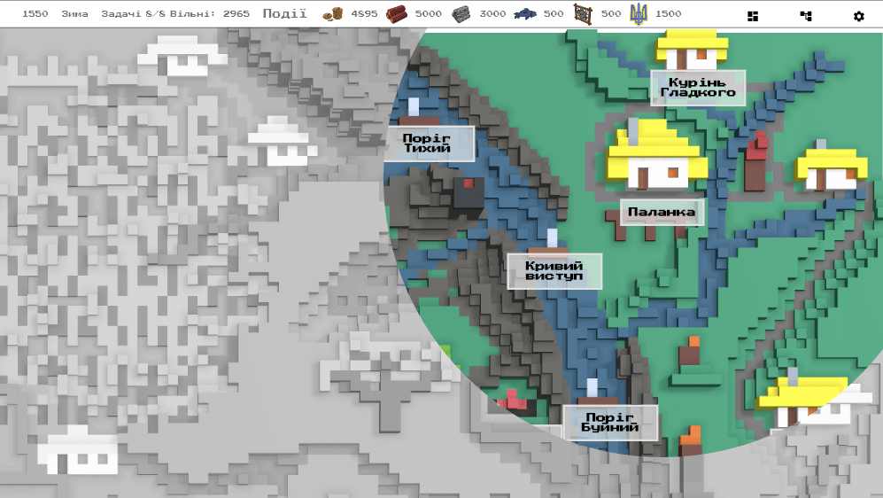

Each location on the map has unique characteristics, but to make use of them you have to capture it. That costs a bit of resources:

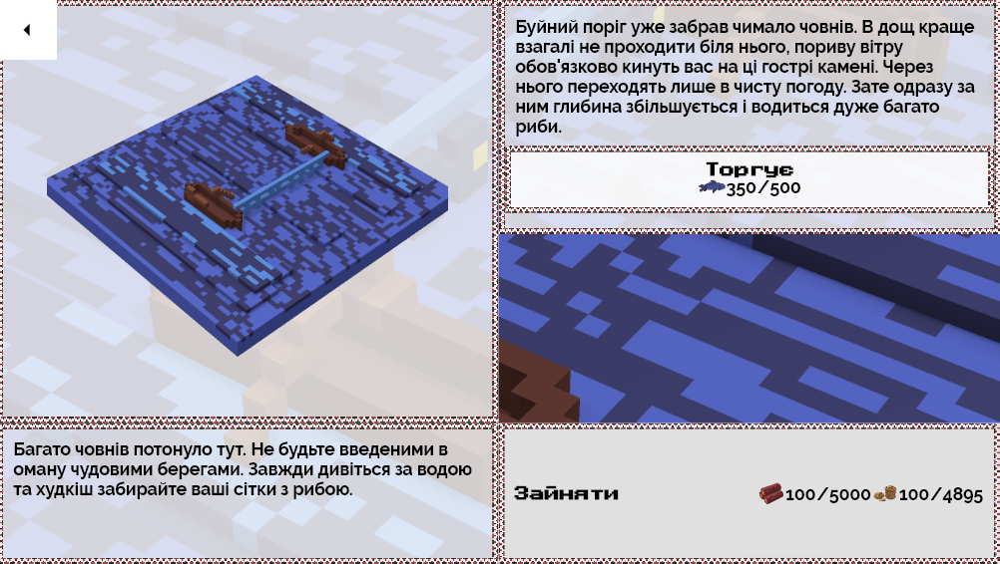

After that you can trade with the new kurin or with the frontier settlers (ukhodnyky):

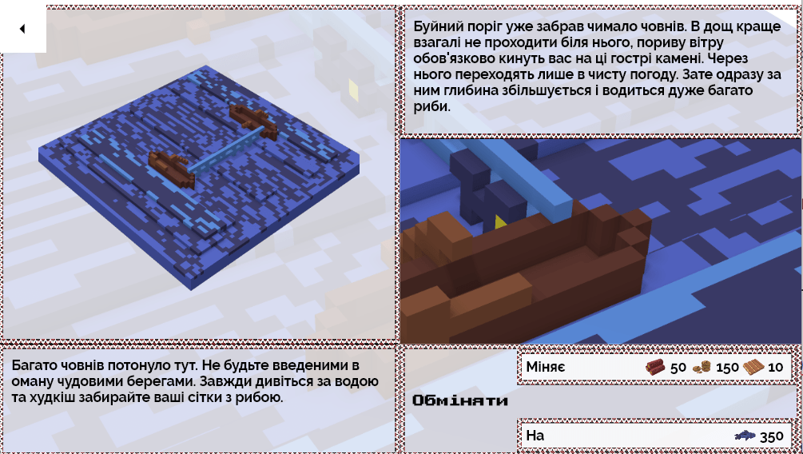

All locations on the map fall into three types:

- resource locations for trading
- military ones, for expanding your lands and advancing toward Ochakiv.
- locations that are simply interesting to capture.

The last type includes the place where Sviatoslav died and the thousand-year-old oak that once stood on the right bank of the Dnipro and served as a gathering point for warriors:

### The Oak:
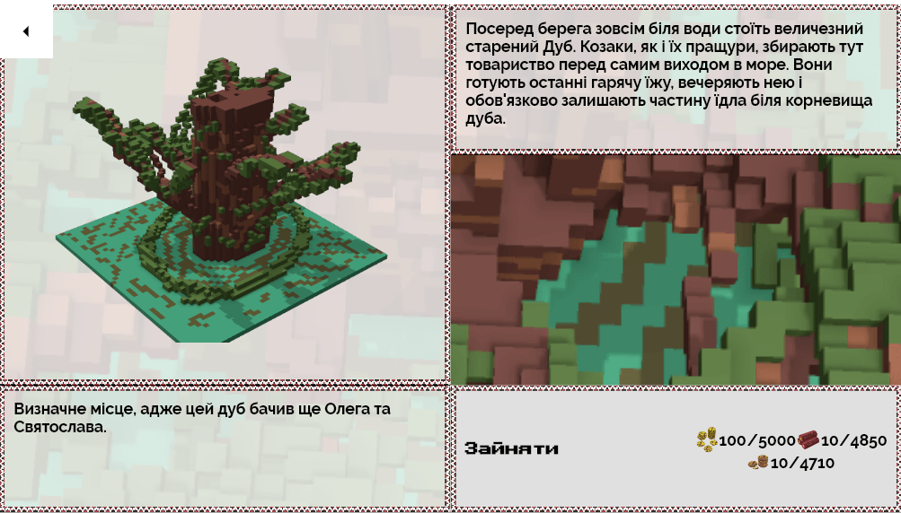

### The Old Altar:
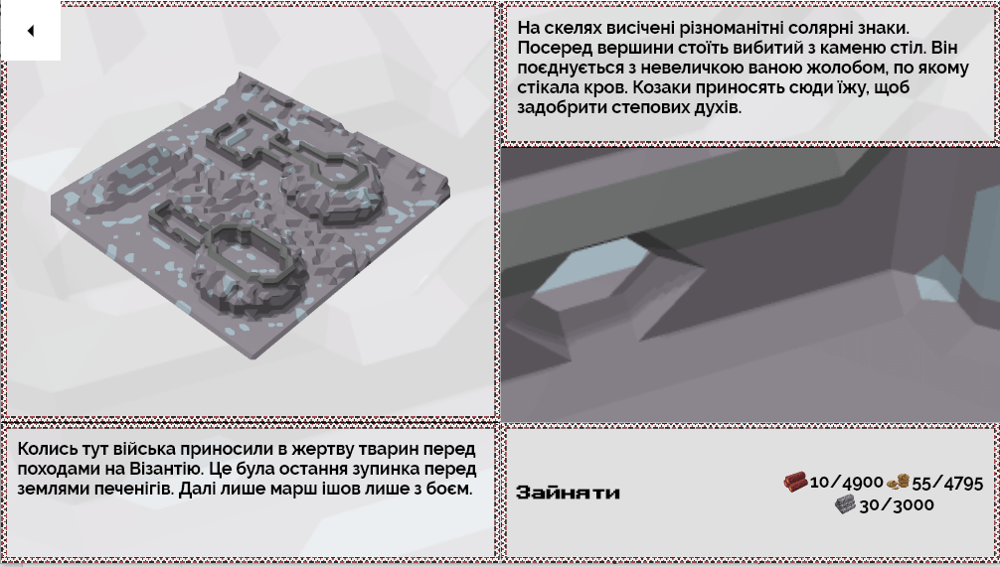

### The Grave of Sviatoslav the Brave:

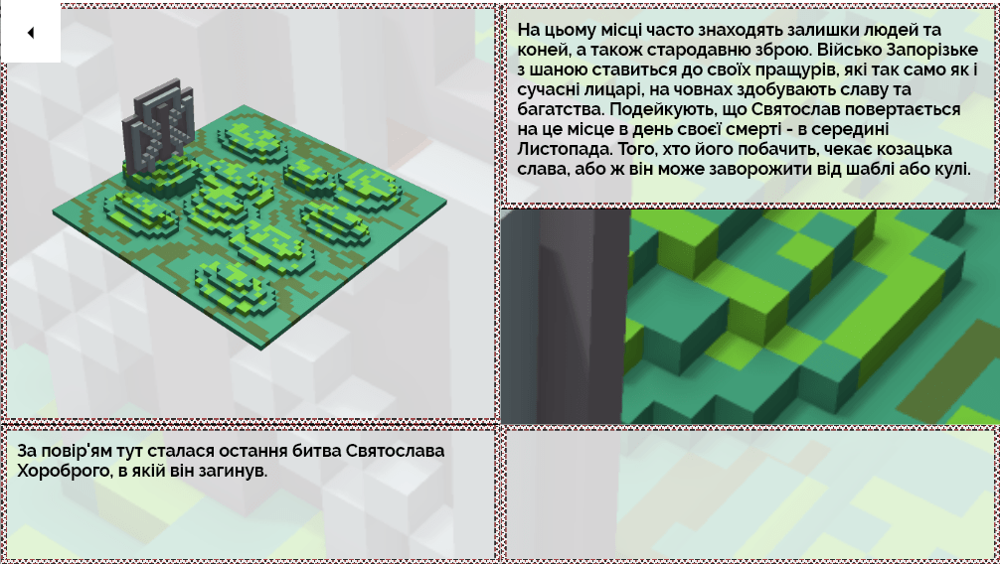

## Expanding the Territory

Once captured, each location reveals the map around it. This way you can expand the territory of the palanka and eventually reach Ochakiv:

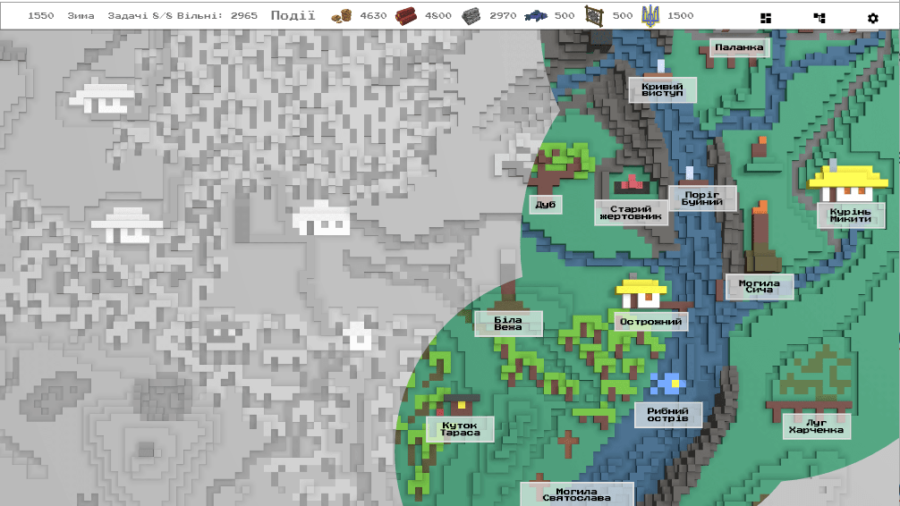

## Every Location Is Unique.

In total, 20 new voxel pictures were added to the game, and descriptions were written for more than 40 kurins and khutirs:

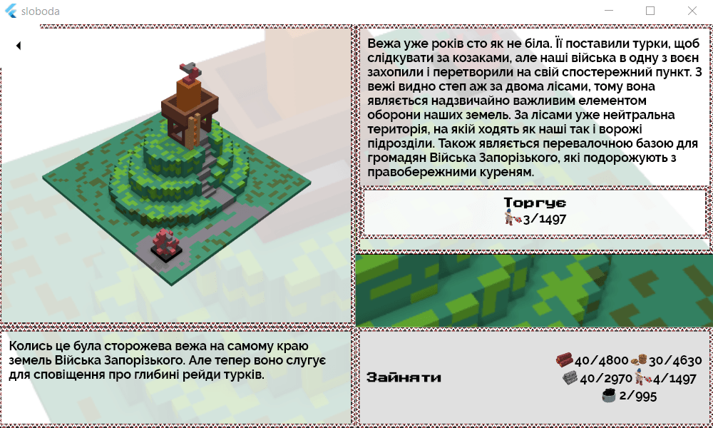

## Military Action

The main goal on the map is to reach Ochakiv and sack it. Back then it was a city of the Ottoman Empire. At the mouth of the estuary the Turks built fortresses that blocked the Cossacks from getting out into the Black Sea.

Advancing along the Dnipro, you will eventually reach their watchtowers:

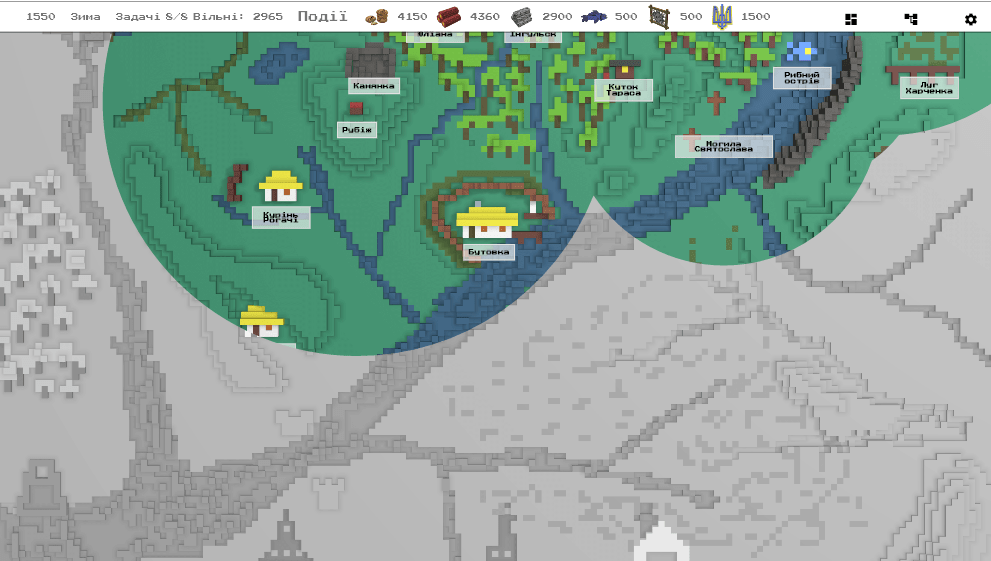

Before you can capture the towers, you have to secure a reliable rear for your troops, namely capture and hold the kurins around the estuary:

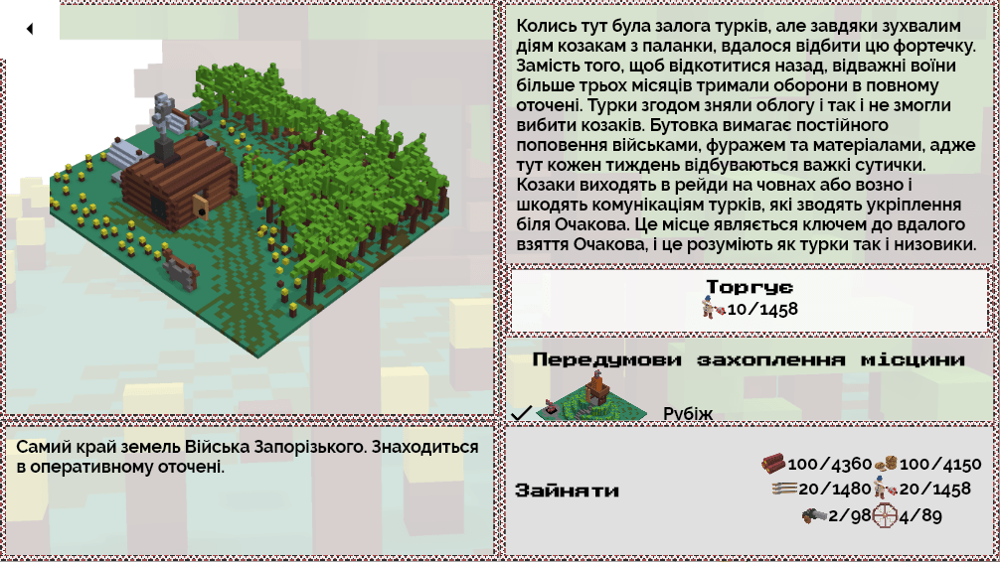

And here is the main target - Ochakiv!

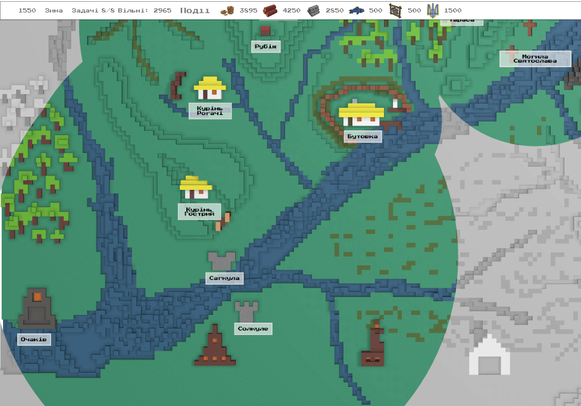

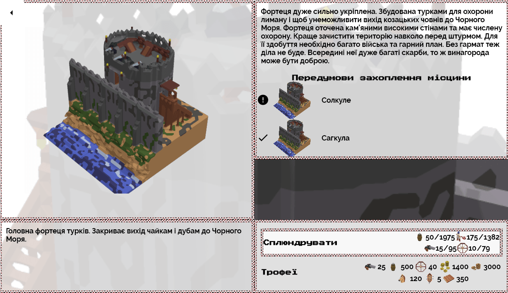

## Capturing Ochakiv

Storming Ochakiv is a very expensive affair. You need lots of troops and resources (wagons, boats, cannons, food). Because before you can take it, you have to sack two defensive towers on the Dnipro.

The reward will be very high. **And the route to the Black Sea will open up for you. Which means that in new versions we will be raiding Asia Minor and the slave markets in Crimea.**
