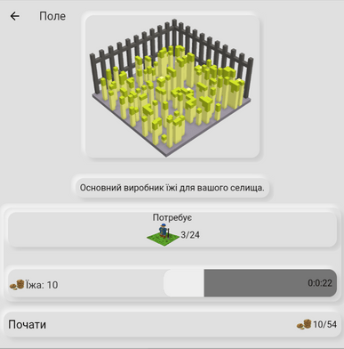
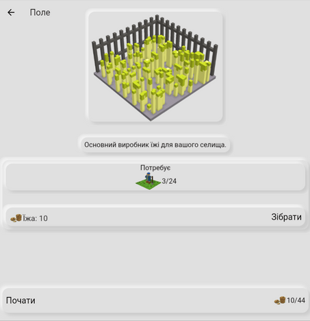
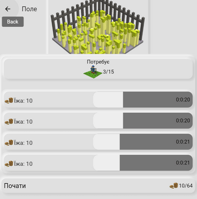
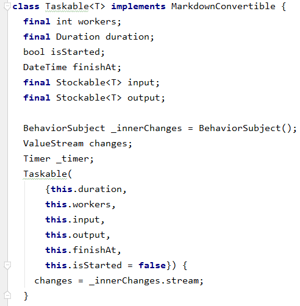
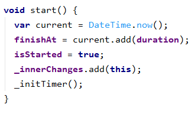
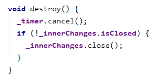
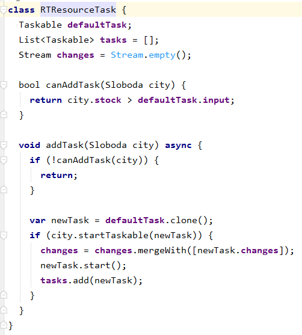
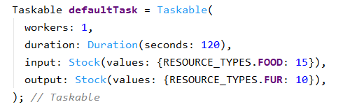
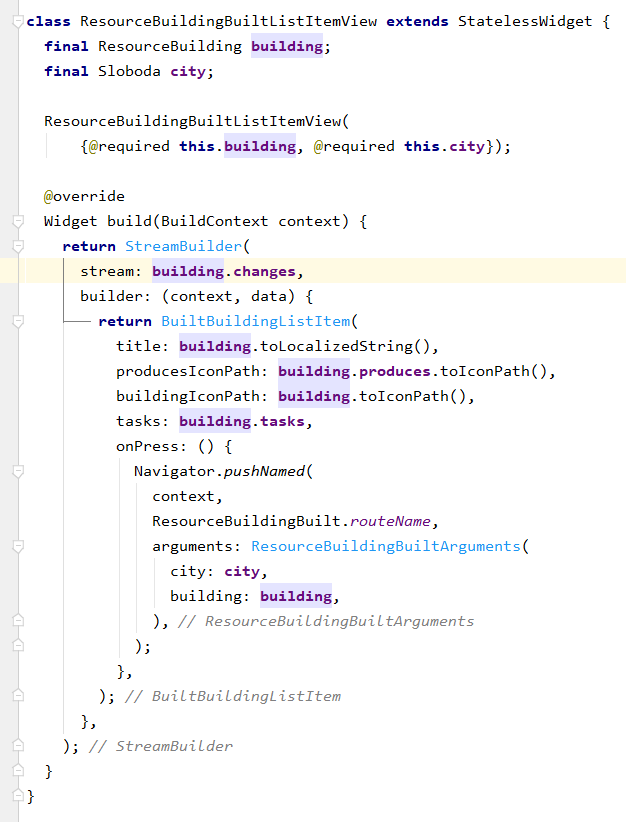

You may have already read the first article in my series on implementing game mechanics:  [Design and Implementation of an Event System in a Turn-Based Game]([[flutter_design-and-implementation-of-event-system]]) . In this article I'll show the design and implementation of the task-based game mechanic that I built in my game  [Sloboda](https://locadeserta.com/sloboda). The game's source code is on GitHub:  [https://github.com/gladimdim/sloboda
](https://github.com/gladimdim/sloboda)
# What's the difference between a turn-based game and a task-based game?

## Turn-based game
A turn-based game is easier to implement, which is why this mechanic was chosen for the first iteration. The developer always has a single point where the game state changes - the player pressed the "End turn" button. While handling that event, it's very easy to process all the states of buildings, inventory, events and statistics.

For example, the algorithm for processing resource generation consists of the following steps:

1. Check whether there are enough resources to start production.
2. Take the resources from the storage.
3. Add the resources generated by the building to the storage.

If step #1 fails the check, move on to the next building.

But this approach also oversimplifies the gameplay itself: the player can, for example, set food production to the maximum and just spam the game with turns. After 10 turns there will be hundreds of food in the inventory, which can already be used for other production. And in 5-10 minutes the player has already played through 20-30 in-game years and has hundreds of resources. The game becomes boring. Even though I added catastrophic game events that can completely wipe out the storage or the people, restoring the Sloboda back to working order still only takes 1-2 minutes of clicking the "End turn" button.

## Task-based game
In this type of game there is no "Turn" button anymore; instead, all manipulations with the Sloboda happen by launching tasks that generate resources. Tasks take some time to complete. When the time is up, the player can collect the result.

For example, the "Field" resource generates food, and production needs only 3 free people:

When the task's time has run out, you can collect the resources into the inventory:

Many tasks can be running on a single resource building:

## Functional requirements

### A task must:
- Define its input requirements.
- Define its output result.
- Define the time it takes to complete.

### A building must have:
- A list of tasks that can be started.
- A list of active tasks.
- An internal timer that checks the completion of tasks in the active list.
- The ability to finish a task and receive its result.
- The ability to start a task by satisfying its input requirements.
- A stream of task progress updates to refresh its widget.

# Implementation
## First, let's implement the Taskable class, which will be the single class for all tasks.

It has an additional property **bool isStarted**, which determines whether the task has already started executing.

**DateTime finishAt** holds the time when the task will be completed. It's automatically set to the right date when the task is started.

The **start** method begins executing the task:

And let's not forget to clean up our timers and streams:

## Implementing task handling in the ResourceBuilding class

Now that we have the **Taskable** class, we can extend the functionality of **ResourceBuilding** so that the building can work with tasks.

To begin with, let's add a new class, RTResourceTask. It extends the class with a list of tasks and a stream. Messages will be pushed into this stream when a task is completed. It will be the bridge between the UI, the building and the tasks inside it:

**Taskable defaultTask** will be defined by each building separately. It's the template for creating a task when the player presses the "Start task" button.

An example of the default task for the Hunter's House:

Now every time a task is added to a building, the stream with the task's status changes is added to the building's stream of changes. And with the help of the **StreamBuilder** widget we can update the task progress on screen:

# Conclusion

The whole design turned out to be surprisingly simple. With just one **Taskable** class and the **RTResourceTask** extension for resource buildings, I managed to switch the game's mechanic from turn-based to task-based.

The game's source code is here:  [https://github.com/gladimdim/sloboda](https://github.com/gladimdim/sloboda)

The game itself is available online: http://locadeserta.com/sloboda, or on the Google Play Store:  [https://play.google.com/store/apps/details?id=com.gladimdim.sloboda](https://play.google.com/store/apps/details?id=com.gladimdim.sloboda)
