# TL;DR

- Research has been added. You can now unlock various inventions in your Sloboda to improve production processes. 
- Added background art for all buildings and resource spots on the map.

# Where to get the game?

The game is available online:  [https://locadeserta.com/sloboda/](https://locadeserta.com/sloboda/), but be careful - development builds are published there.

Release builds of the game are available on the Google Play Store:  [Wild Fields: Sloboda](https://play.google.com/store/apps/details?id=com.gladimdim.sloboda) 

You can also download the APK and Windows builds directly from GitHub:

 [Release 2.9.0 on GitHub](https://github.com/gladimdim/locadeserta/releases/tag/2.9.0-sloboda) 

 [Android APK build](https://github.com/gladimdim/locadeserta/releases/download/2.9.0-sloboda/sloboda_2.9.0.apk) 

 [Windows 10 build](https://github.com/gladimdim/locadeserta/releases/download/2.9.0-sloboda/sloboda_290.zip) 

# Gameplay changes

The player can now spend earned Glory and resources on unlocking research.

To open the list of available research, tap the new button:

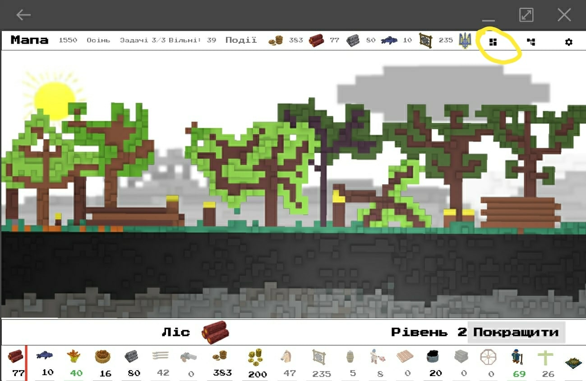

There are currently 7 inventions available, and they significantly improve the efficiency of production chains:

## Double Plough

Makes field work much easier.

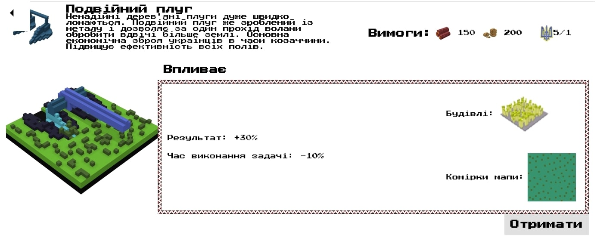

## Vertical Saw

Planks are sawn faster at the sawmill.

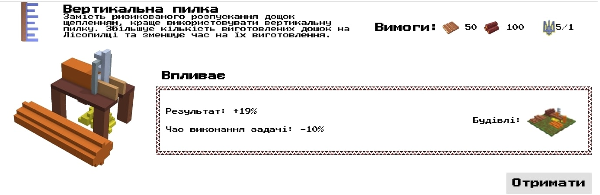

## Sturdy Net

Fishing yields more.

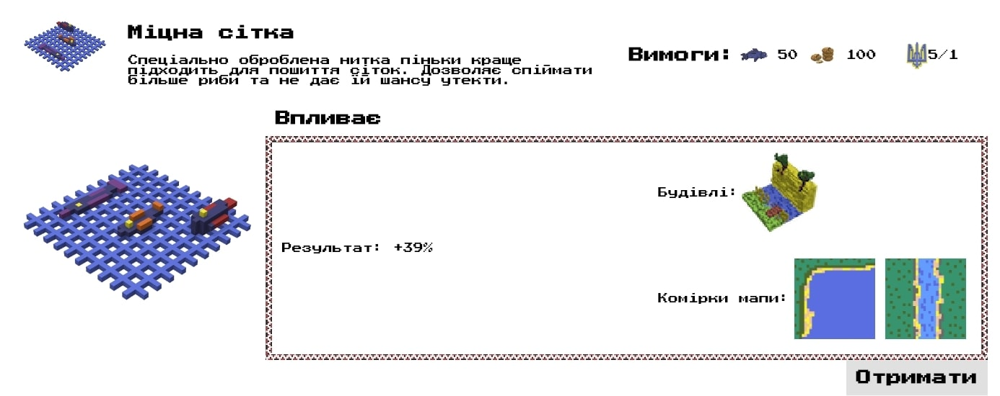

## Muscovite Lock

Standardized production of Muscovite locks for muskets.

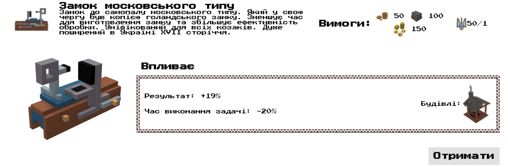

## Tatar Horseshoe

Helps raise horses for the army faster.

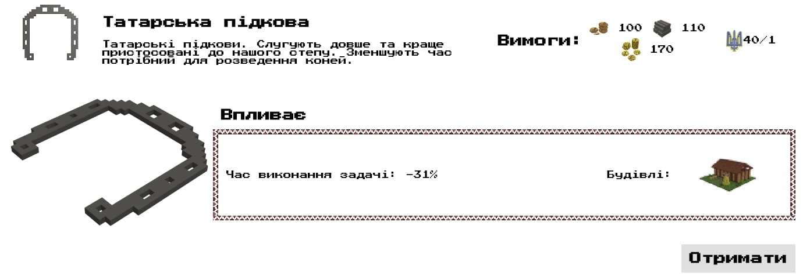

## Lightweight Axe

Chopping trees has become easier. Reduces task time and increases output.

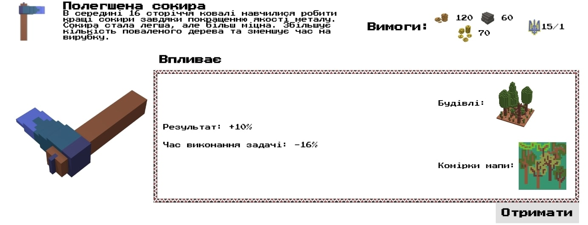

## Improved Anvil

Working with metal has become easier. 

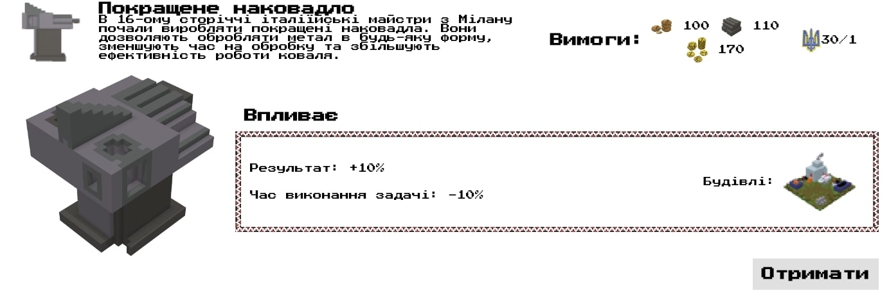

# More varied building visuals.

The screens showing a building's production details have become more varied. About 20 new pieces of background art were added:

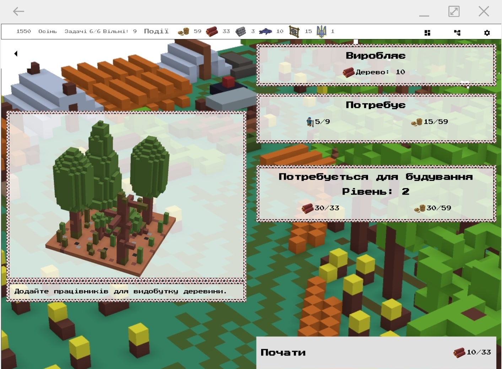

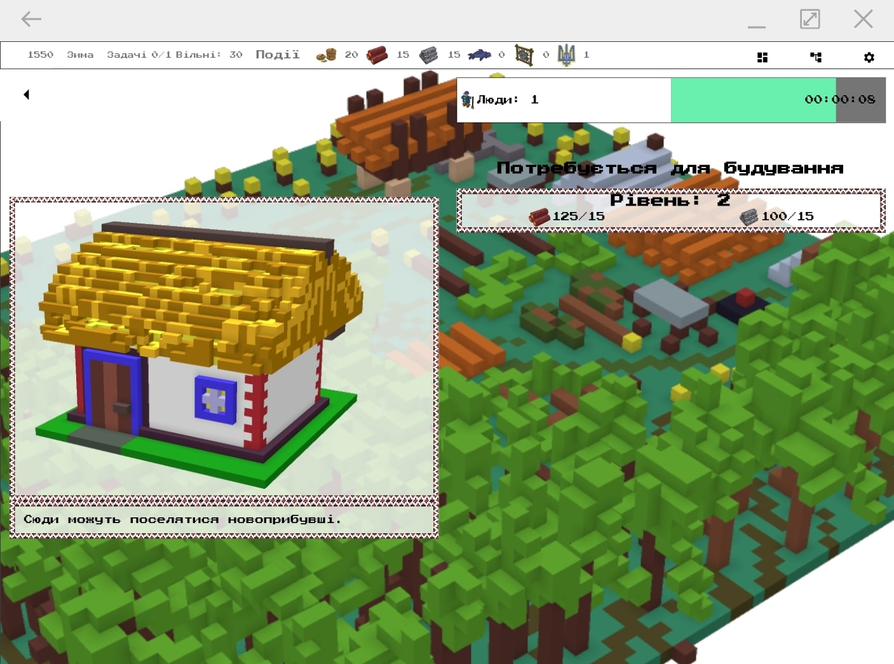

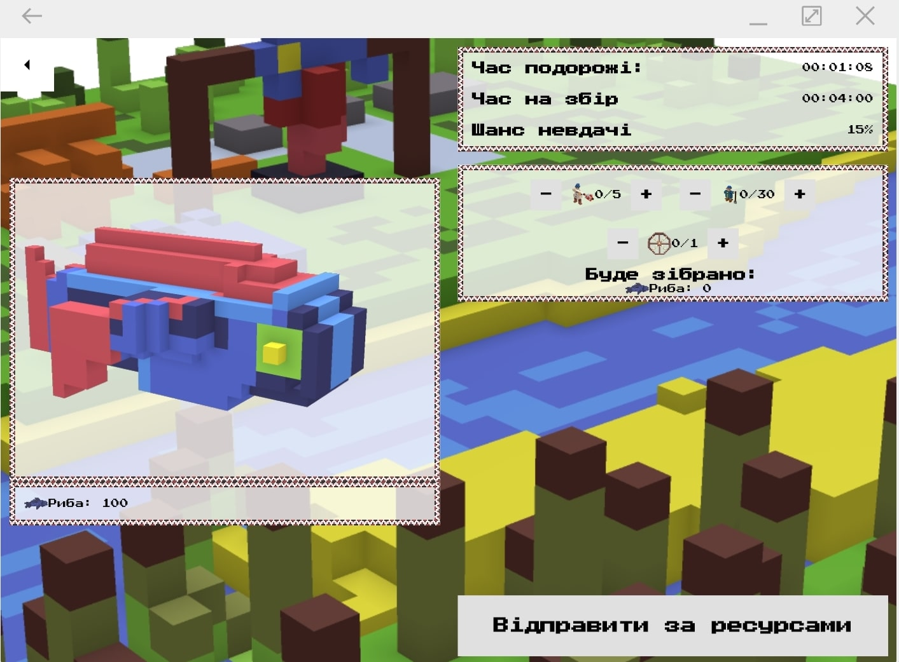

## Color-coded task status in buildings

It used to be hard to tell which building had finished production and which was still working. Now it's easier thanks to color-coded task status. Blue means work is still in progress. Green means all tasks are done:

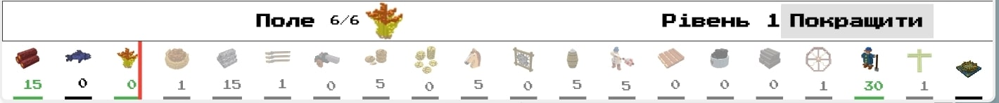

# Glory

You will also earn Glory for successful military or hunting expeditions. These points can then be spent on unlocking research. So build up your army, go on campaigns and win Glory!
