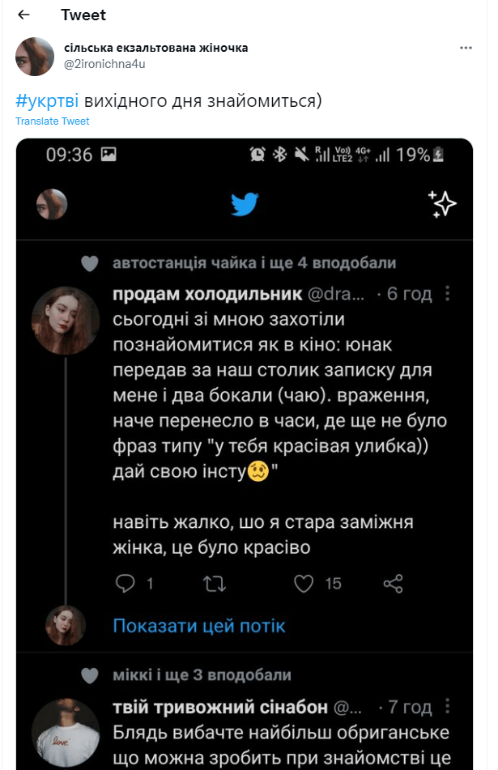
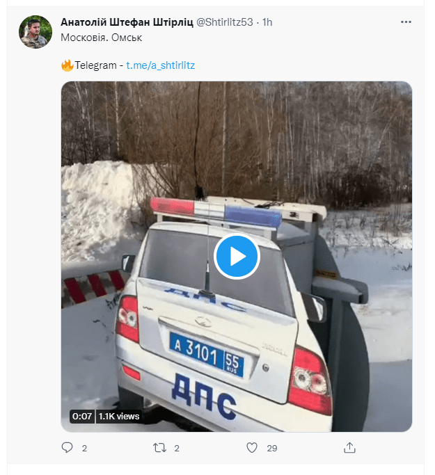
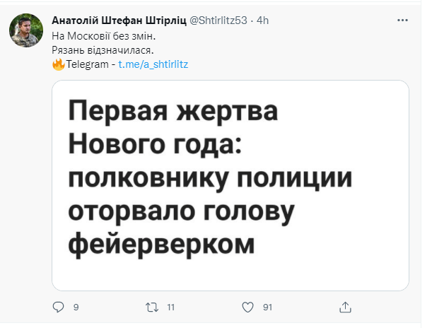
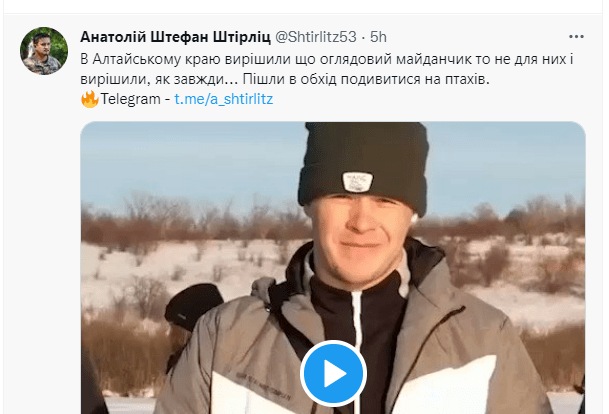
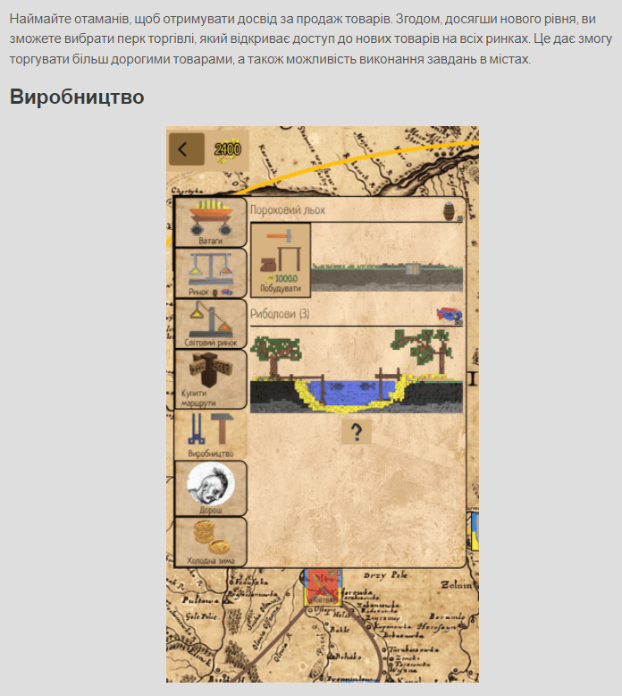

Every now and then I dive into the world of #UkrTwi, and every time I regret it.

Almost all the accounts with thousands of followers are some kind of whores who once a month post a tit/pussy/ass and get 500 likes within an hour. Or just garbage tweets about nothing:

[https://twitter.com/2ironichna4u/status/1474600064609751040?s=21](https://twitter.com/2ironichna4u/status/1474600064609751040?s=21)

And they have 2,000-8,000 followers: [https://twitter.com/2ironichna4u](https://twitter.com/2ironichna4u)

I took this account as an example because I still have the screenshots and a post from Mastodon. The rest of the junk with 500 likes a day has exactly the same content. That is, zero.

# What I'm talking about

When junk like this becomes popular, it doesn't let anything else grow. Do you know any Twitter accounts of people who make art, music, sounds, games, or just something interesting? Apart from dumb photos of a cup of coffee in hand by the window, or a joke "that only Galicians will get", there is almost nothing on Twitter in the Ukrainian segment. And it turns out that against this backdrop of weeds, truly cultured plants simply can't break through.

# 100% politicization of everything

Another huge problem: our whole online space is controlled by a couple dozen Telegram channels with news, "insider info" and some other crap.

Here's the agenda they create:

- KIVA SCRATCHED HIS DICK
- PHOTOSHOP MEMES OF ZE
- LENKA'S OUTFIT
- SOMETHING BLEW UP IN RUSSIA HAHAHA
- PHOTOS OF DRUNKS WITH A CAPTION SAYING SOMETHING ABOUT RUSSIANS

And every day it's something new, yet the same. People are constantly made to live in yesterday or today. And everyone thinks that once he's liked a photoshop meme or a video of something blowing up in Russia, that's it, he has contributed something to our culture or information space. Look at all those tweets even from a month ago. It's all trash, not even worth your attention while you're taking a shit, because its half-life runs from morning to lunch. And tomorrow everyone gets fed a new photoshop meme, or a bad photo of Poroshenko/Zelensky. And a horde of hamsters runs off to repost it, like it, send it to each other on Telegram and discuss it in the kitchen.

# Building the idea of "as long as it's against Russia"

The whole agenda is built on the idea of doing everything to make Russia butthurt, to get into their crappy news on ORT, or to make Skabeyeva or Solovyov start a flame war on Twitter. Then all these clips from their news get heroically reposted on Twitter and celebrated as a great victory.

What's actually happening: we are constantly being kept inside the information space of the aggressor state.

Just some examples from such Twitter giants over the last day:

90% of it is posting some trash from Russia, 5% is photos of the wounded and 5% is links to a PrivatBank card or Patreon.

Or how about making 100% of the news about our own country? Is a video of drunk Russian traffic cops really worth more attention than the stories of our soldiers? Do you really need to see and know that? In 10 minutes you'll forget about it, but your energy will already have been spent on it, and you'll have no strength left to do anything else.

Look at what Yuriy Butusov does, for example: he has recorded literally kilometers of interviews with our soldiers. There are hundreds of hours there that could be cut into clips. Instead of reposting a video of a head blown off by a firework.

By the way, this real colonel completely ignored my request to retweet a tweet with the news about the release of my game about the Cossacks: [Sloboda and Chumaky](https://locadeserta.com). So did a couple of other titans with 5k+ followers. [Oleksandr Kolym (@OleksandrKolym) / Twitter](https://twitter.com/OleksandrKolym), the Wikipedia admin and someone else I've already forgotten). Well, in defense of the Ukrainian Wikipedia admin, I'll say he did repost the news about the interactive stories. The only one out of a dozen. It's so much more interesting to post clips from ORT of Zhirinovsky getting into a fight with someone, or drunk traffic cops in Bryansk falling into a river.

And here, some dude wants a retweet just because he made a game about Ukraine. It's not like we have thousands of games coming out every year...

# Why this is bad

Our entire information space is covered in shit. Titans with tons of followers post Russian news, sluts show half a tit for likes. And that's it. The space is filled. Every twentieth person forwards it to someone else, and boom, there are already topics for kitchen conversations. As if you've done something good for the country. You wake up in the morning and it all starts over. Groundhog Day and absolute degradation.

Here I am making a remake of the game Sloboda, [Wild Fields: Sloboda](https://t.me/locadesertachumaki), but I've already decided not to target Ukrainian society and to go straight for the European audience. Their heads aren't stuffed with photoshop memes and videos, people actually create things and share something new and interesting. And on top of that, they support those who make something. Besides, many of my friends and acquaintances perceive my activities in the spirit of "what the fuck, you're doing something interesting here instead of the same shit as me? Let me crap all over you on Facebook or in DMs to shove you back into the swamp". And I heard this from people who are supposedly patriots and with whom I went on more than one hike. Not one of my former fellow club members from Cossack reenactment even reposted it on Facebook.

# Why we need to do something

Do you want the culture to develop and spread? Look at how the Russians do it. They already have games about the Slavs, and it's a cool strategy with action elements. They create a game and thereby put their vision of events into the players' heads. That the Moksha swamps are Rus'. That Ivan IV, a great-great-grandson of Genghis Khan, is a Rurikid. And that's it. People play the game and it gets programmed into them automatically. And all of it goes to the West too. That's why everyone sees us as post-Soviet, as if we're all Russians. And Ukrainians just made themselves up.

What do we have: the game Cossacks, which is 22 years old. The game S.T.A.L.K.E.R., which is 100% Soviet. And a new S.T.A.L.K.E.R. is coming out soon. Where the whole plot is Russian.

I once read an article about how the Vikings became popular in media and books. Simple: in the 1970s the Scandinavians released 2-3 films a year about their history. They came up with horned helmets and berserkers. Now look at the cultural expansion they actually achieved: everyone knows about the Vikings (including that they brought culture to our lands), everyone recognizes these character types. And here on Khortytsia, drunks in sashes and bare-chested show how they knocked Polish hussars off their horses with the hopak... And when you point out that it's all nonsense, they threaten to beat you up.

We neither create anything nor let anything spread when someone tries to create something. And then the wild brawl begins: BECAUSE, YOU SEE, S.T.A.L.K.E.R. HAS NO UKRAINIAN VOICE-OVER. And why in the new Age of Empires 5 did Rus' start from Moscow, with Mongoloid-looking faces in the pictures???

Well, because all you're capable of is reposting photoshop memes and "just blurting out something against Russia".

**So, everyone interested in something new, come to my Telegram channel [https://t.me/locadesertachumaki](https://t.me/locadesertachumaki), where I post news about the game Sloboda 2.0. Find my old games and share them: [https://locadeserta.com/](https://locadeserta.com/)**