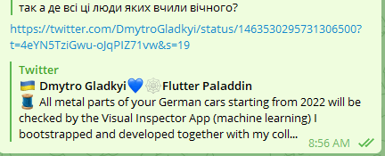

I'm forced to write this post, because lately the "IT" crowd (I hate that word) keeps spreading the idea that a technical education is unnecessary and gives you nothing.

This is said both by people who got a degree and by people who didn't.
DOU especially promotes it: they started putting out lots of video interviews with all sorts of people, and almost all of them claim their education was useless and gave them nothing.

This plague is also popular among thought leaders.

```
For some reason humanities folks get triggered right away, explanation in the TLDR
```

# TLDR

Render unto Caesar


# The Beginning

Of course, no specific names below, just a couple of examples I've seen in comments on DOU, as well as on their own YouTube and Telegram channels:

- a delivery-ward manager (sorry, I mean delivery manager) at some backwater shop. Education: maritime college
- the CTO of a team of 3 cripples that takes jobs off Upwork. Education: correspondence course
- Chief-Something-or-Other-Officer of an online sales almshouse. Education: Engineer
- Owner of a big Telegram channel full of nonsense. Education: Philologist (made it through 3 years).
- JavaStriptease artists of all stripes. Education: vocational schools, pedagogical universities, culture institutes, KNEU, the food-tech university.
- Professional clowns who give JavaScript talks at conferences. Education: who knows.
- Mega-JSers, freelancing, mind you, with 15-20 jobs a year.

# Why I Agree with Them

Indeed, if your job is to "deliver" and to "shoot the breeze" with the customer, then no education from KPI or Shevchenko University will help you. Also, if the result of your work is an online sneaker store (sneakers flipped by hustlers from AliExpress), then what do engineers have to do with it at all? And what does Computer Science have to do with it? If all you do at work is lay out React components. Well yes, 100%, you don't need any technical education. You need something entirely different - marketing, advertising, business management.


In the same way, **if I had studied to be a philologist**, then gone on to become a **React dev**, and started whining on YouTube that **my philology degree is crap, gave me nothing, I wasted 5 years of my life**...WTF? Where's the connection here?..


# But

Many of them bought a microphone and a camera and started preaching to the people about how cool their work is (but the product is secret, can't show it...), how they wasted 5 years of their lives at Shevchenko or KPI, how dumb the lecturers were, education at a 1970s level...Horror.


But before you believe them, look at what they actually do. As I described above, it's usually some lame bullshit nobody needs, and most importantly, the result of their work has no impact on anything and gets easily thrown away or replaced 3 months later.

# Hold On, So What's Your Own Background?

You won't believe it, but this exact question gets asked by one of those thought leaders.




(link from the screenshot: https://twitter.com/DmytroGladkyi/status/1463530295731306500?t=4eYN5TziGwu-oJqPIZ71vw&s=19)

That is, it doesn't even cross their minds that KPI or Shevchenko University might actually teach something interesting and useful, rather than what their level of development allows - **chewing over the difference between OOP and FP**, writing articles about **monads** 5 minutes after learning about them, or how to properly fire a person so they don't take the laptop home.

**I graduated from the Department of Technical Cybernetics, Faculty of Informatics and Computer Engineering (FIOT), KPI. I'm sure my education was necessary**. Because what I've been doing for 10 years now is exactly about engineering industrial systems.

Here is a more detailed example, in English, of what I've been doing for the last 2 years:

https://twitter.com/DmytroGladkyi/status/1465311158873858049

Visual defect analysis in manufacturing, which is already running at a **BMW & Porsche** joint venture.

Integration with various ML model vendors, reporting, bring-your-own-models, bring-your-own-data, on-the-fly training...

How about that? Scroll back to the top of the post and compare it with what the opponents of engineering education (let's call it that instead of technical) are doing.

The most they can blurt out is "I built a landing page for Porsche on nextjs, invite me to a conference and I'll tell you how".


Yes, FIOT didn't teach me how to manage 3 cripples on Upwork.

Yes, FIOT didn't teach me how to code React components for crap that will be rewritten in 3 months.

Yes, FIOT didn't teach me how to spin up Dockers on AWS.

Yes, FIOT didn't teach me how to run shady deals through 400 sole-proprietor (FOP) entities selling costume jewelry.


Because that's all bullshit. Dog shit. It has as much to do with technical education as your digging potatoes as a kid has to do with an agronomy degree.

# What Exactly Was Cool at KPI or Shevchenko University

During a discussion in a Telegram channel, people started recalling what was actually good there.

I'd gladly take these courses all over again:

- **Signal Recognition Theory**. This is a mega topic. SOMETHING comes in as your input, and you have to recognize whether that SOMETHING is just SOMETHING, or the specific SOMETHING you need. (almost like APIs made by React devs lol). Of course, if you have school-level math and the dorm is downing the second bottle without you, it all seemed like bullshit to you. You'd already gone off to work as a PHP guy, or pulled cables for an internet provider, lol why would you need any signals.
- **NMC (ЧМО). Numerical Methods of Computation**. Everyone whines that KPI didn't teach them O(n).  That's like complaining that the Architecture university didn't teach you how to chew pencils. Go to the wiki [https://uk.wikipedia.org/wiki/Чисельні_методи](https://uk.wikipedia.org/wiki/Чисельні_методи) and read what this subject is about. It's such mathematical preparation for programming that I don't know what else would be.
- **Circuit Design**. Somehow this was one of my favorite subjects. We designed chips for various algorithmic devices...Wait, but KPI didn't teach anyone algorithms! Of course, if you were boozing in the dorm and reading news that someone in dorm VI crapped right into the soap dish again,  then you went and bought your coursework and never even found out what it was. And now they whisper into their microphones that nobody taught anyone anything, poor things.
- **DBMS**. I can already hear the howling: LOL IT WAS FOXPRO ON MS DOS LOLOLOLO. **So what, does database normalization depend on the software package?** Or on whether you input with a keyboard or a mouse? I officially declare that for 5 years after graduating you could have woken me up at 4 a.m. and I would have spread your crappy Mongo across the tables of some proper Postgres at a given normalization level. Hell, without that they wouldn't have even hired me as QA back in 2008.
- **Descriptive Geometry**. There was both the "manual" kind and the one in Kompas/AutoCAD. Many people spit on it, but that's just how it is - an engineer must be able to read schematics. It also develops the visual part of the brain so well that it should just be taught to everyone. Not to mention if you're drawn to gamedev...
- **Higher Math, Calculus**. Higher math for an engineer is like a cross-country run for a soldier. It just has to be there, I don't even know what there is to discuss. Personally, I went through the whole calculus course in 11th grade while preparing for university admission, so the first two years seemed, well, kind of easy...Then I paid for slacking off for two years :)

# What I'd Throw the Fuck Out of KPI

- **Paid-tuition students. Just fuck off** to a separate sub-unit of the faculty. Why should I look at these calf-like faces whose parents shoved them in here "because computers (c)". Their only task was to bring the payment slip for the next semester to the dean's office. That's it. Exams closed. If they passed the exams on their own, transfer them to the sub-unit with normal students.
- **Humanities crap**. We studied a pile of useless crap: philosophy, philosophy of science, political science, sociology, bullshitology. And all these lecturers felt their own intellectual clumsiness, and for some reason always hammered ordinary techies, who, honestly, couldn't give a fuck that Kant wanted to bang another philosopher's sister, she turned him down, so he started his own school and now we all have to study all 15 German schools of philosophy. I don't know how, but passing these "subjects" always somehow required titanic effort from everyone. They'd better have thrown in more calculus, or algorithms. Why doesn't the Philology faculty teach NMC or Circuit Design? Let them develop in every direction...
- **Lecture notes**. This is just fucked up. Admission to the exam - LECTURE NOTES WRITTEN IN YOUR OWN HAND. Some dickheads actually checked your other notebooks. What is this, the Kyiv-Mohyla Academy of the 17th century? Where a student's only task was to write down what the lecturer dictated.
- **PE**. Fucked up, I don't even know why. And on top of that you had to walk 30 minutes through the ruined slums of an industrial zone.
- **The dean's office**. If anyone complained about the housing office, the dean's office is the pinnacle of humiliating any human being. The Queen of Britain herself would have abdicated the crown from sheer degradation after a visit to the Dean's Office.
- **Foreign students**. Put them in a separate group too. They didn't even know Russian, and here's calculus in Ukrainian on top of that...


Other than that, I don't know what else. If all of the above were thrown out, it would've been top-notch for me.


# What I'd Add to KPI

- in the 2nd-3rd year, more complex assignments that flow into one another. For example: building some product from data structures, DBMS, services, up to the UI representation. I was lucky with my coursework and thesis supervisor: we started a topic in the 3rd year and worked on it all the way to my master's thesis defense. And yes, we deployed it at KPI, it wasn't just theory. It was super.
- More technical subjects instead of humanities.
- Choice of subjects after the 3rd year. I just don't want to study the Theory of Automated Control. Give me a choice. I want more databases.


# Conclusion

If you want to go into management, do HTML layout, or work on products that will die in 3 months, then you don't need a technical education. Some outsourcing galley will gladly take you and you'll pedal your React there. But don't go telling everyone that technical education is rubbish.

**But if you really want to reach another level, work on truly interesting and useful products, then an engineering education is a must-have. I'm even sure that those who got one and now cry that it gave them nothing actually reached their peaks only thanks to it. And if they had studied instead of just showing up, they would have jumped even higher.**
