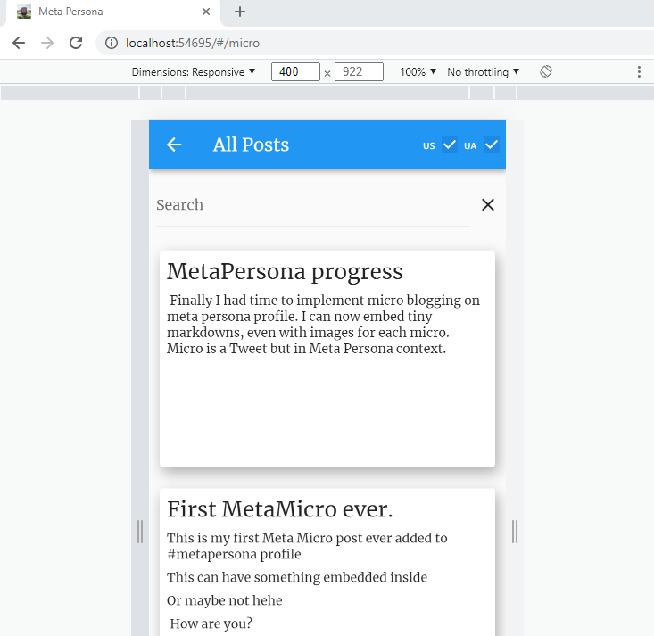

# MetaPersona progress

 Finally I had time to implement micro blogging on meta persona profile: [This site](https://dmytrogladkyi.com) I can now embed tiny markdowns, even with images for each micro. 

 Like this:  

 Micro is a Tweet but in Meta Persona context. Check sources on [https://github.com/gladimdim/metapersona](https://github.com/gladimdim/metapersona)