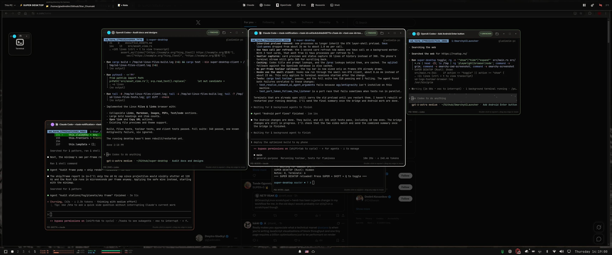
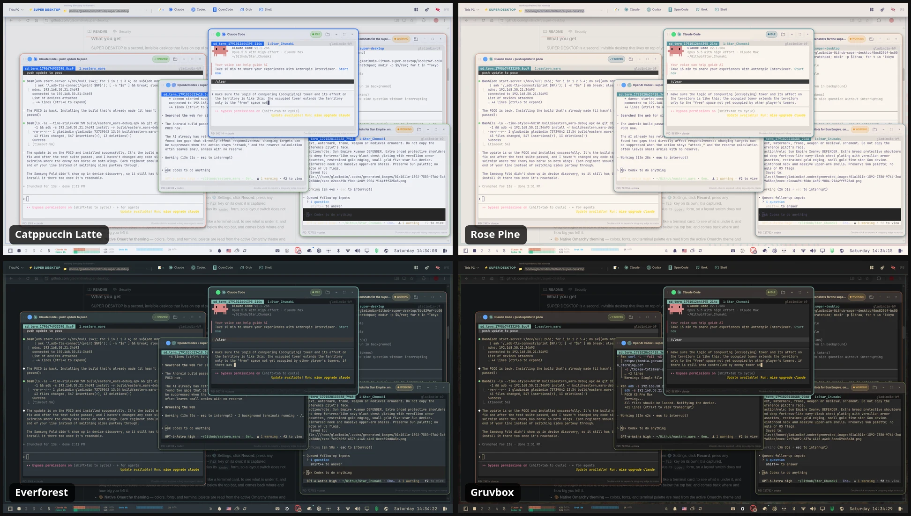

<a class="omarchy-portal" href="https://omarchy.dmytrogladkyi.com/">
  Explore all my Omarchy work<strong>omarchy.dmytrogladkyi.com</strong>
  ↗
</a>

# My work for Omarchy

I’ve built a lot for Omarchy: desktop apps, plugins, phone and watch companions, and themes. From SUPER DESKTOP and Omakey to config sync and AI usage tools, it’s all part of making this desktop my own. You’ll find the full collection on my dedicated Omarchy site above.

## SUPER DESKTOP in action

My overlay workspace brings AI terminals and sticky notes together, one shortcut away. Here’s a look at it on the desktop and across Omarchy themes.

<figure>
  
  <figcaption>SUPER DESKTOP — AI agents and notes, right where I work.</figcaption>
</figure>

<figure>
  
  <figcaption>The same workspace, at home in light and dark Omarchy themes.</figcaption>
</figure>
